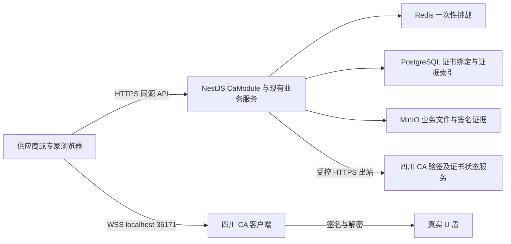

# 四川 CA 接入方案

初稿日期：2026-10-10；最后复核：2026-10-12。适用项目：智慧水发招采 ERP，`water-erp/`。状态：已按当前工作区代码再次审核并修订，尚未实施。

本方案按用户确定的资料优先级，以 `四川CA/sccm-JAY` 文件夹中的 SDK、示例及 JAR 为接入主依据，结合当前项目代码制定；Word 仅供流程参考，冲突时以开发包为准。本文确定接入架构、业务规则、改造边界和验收顺序，是设计交付，尚未实施，也未通过真实 U 盾或 CA 网关联调。下文明确区分资料已证明的事实、设计决定和上线前必须核实的运行条件。

2026-10-12 新增配套 [前端 UI、后端接口与数据契约复核版](2026-10-12-scca-ui-api-contracts.md)，与本文共同组成最终设计。该附录明确页面/文件落点、请求响应、数据库约束、草稿保密、并发状态、限额及验收；跨模块字段与数值统一按其第 2 节，本文保留总体架构和阶段决策。

## 1 方案决定

采用 **Next.js 调用四川 CA 本机客户端，NestJS 统一对接 CA 云端验签，ERP 保留账号与业务权限控制** 的架构。

服务端固定采用开发包 `SccaGwSDK` 的 `api/signature/verifyPkcs7` 网关协议，由 NestJS 实现与 SDK 一致的请求编码及 HMAC-SHA1 鉴权。Java JAR 是协议基准与对照依据；首期不直接部署 JSP，也不新增 Java 常驻服务。Word 中的 v2 `verifySign` 不列入本次接入，不再要求先补齐 v2 资料。

供应商端先完成真实证书识别、绑定、登录及基础自检，再完成投标签名、开标解密和业务签名。专家端复用同一适配与验签服务，在个人证书样本到位后接入。按用户本次范围决定，暂不考虑 PDF/OFD 电子签章，不列入实施阶段、验收或厂商资料前置要求；投标及业务数据的 P7 数字签名、验签和证据归档仍在本次范围内。

保留现有 SM4 双层文件加密和开标流程，新增 `dual-v3` 信封承载四川 CA 的 P7 密钥封装。`dual-v2` 按旧格式继续读取；不会通过修改字段含义让原始 SM2 密文与 P7 密文混用。

### 选型比较

| 路线 | 适用性 | 决定 |
|---|---|---|
| NestJS 按开发包协议直接调用 CA 网关 | 请求字段、鉴权及编码可从 SDK 核实，与现有技术栈一致，无新增 Java 运维 | 本次主方案，以 SDK 等价性及实盾结果验收 |
| Java 服务包装当前 JAR | 可直接复用厂商客户端，但仍调用外部 CA，并增加运行时与依赖维护 | 仅在厂商支持条件或兼容性验证确需使用 JAR 时评估，不作为默认部署 |
| 在 ERP 本地完成全部 P7 验签与证书状态验证 | 当前项目仅具备部分 SM2/X.509 能力，资料未给出完整信任、吊销、P7 与时间戳验证契约 | 不作为首期方案 |

开发包已足以确定本次协议实现，后续核实重点是可用凭据、测试盾行为、证书验证范围与生产部署条件。本文统一称其为“开发包协议”，此前用于对比的“旧协议”不代表厂商已宣布弃用。网关协议由后端固定，禁止运行时自动切换到 Word 的另一套接口。

## 2 已核实的资料事实

| 资料或代码 | 已核实内容 | 对方案的影响 |
|---|---|---|
| Word 集成说明（仅参考） | 说明 PIN、P7 签名、云端验签流程，但 HTTP 接口和字段属于另一套 v2 接口 | 仅参考流程，不引入其接口、字段或缺失资料作为本次依赖 |
| `sccmPlugin.js` | 本机地址 `wss://localhost:36171`；签名证书和加密证书分别导出；加解密使用 Base64 P7 数据 | 新增专用适配器、双证书模型和有格式标识的密钥包装 |
| Java `SccaGwSDK` 字节码 | `certLogin` 和 `validateSignaturePkcs7` 均调用外部 `api/signature/verifyPkcs7`；使用 HMAC-SHA1 鉴权、`app_id` 头和表单编码 | 作为 NestJS 请求实现基准；仍依赖云端，调用鉴权与 U 盾签名算法分开处理 |
| Java `certLogin` | 自动给网关参数 `toSign` 加 `LOGONDATA:`，P7 签名值原样发送；传入的 `projectId` 未被使用 | 登录完整原文由 ERP 预先加前缀并交给盾签署，网关层不重复添加；项目授权另行校验 |
| `certLogin.html` 与 JSP | `txtToSign`/`ToSign` 字段不一致；前端使用 `Math.random`，签名原文未加上述前缀 | Demo 可作接口示例，不能当作完整认证实现 |
| SDK WebSocket 分发 | 每次请求覆盖同一个 `onmessage`，无请求关联 ID | 适配层必须串行化操作，轮询不能与签名抢占回包 |
| 安装包说明 | 本次提供 `sccpInstaller.exe`，说明要求 Windows | 用 Windows 实盾联调；ERP 服务端仍可部署 Linux |
| 当前 UKey 实现 | `VendorUKeyAdapter` 连接自制 `127.0.0.1:17999`；多个前端状态探测直接依赖该实现 | 新厂家不是只增加一条下拉选项，需要同步改探测和会话管理 |
| 当前证书绑定 | 供应商已有 DER 解析、PoP 和可选链校验；空信任库会跳过链检查，吊销检查存在空实现 | 复用框架，真实 CA 生产模式必须收紧，不视为已完成真实证书验证 |
| 当前双信封 | 文件为 SM4 两层；`kself/kadmin` 为原始 SM2 C1C3C2 密文 | 供应商侧 P7 包装需要新版本；文件层不必重写 |

开发包 JAR 先按网关 `result_code=0` 处理，随后解析 `body.certBase64` 并包装成 `code:"200"`。NestJS 直接对接网关时，以 HTTP 成功、网关业务码成功、响应结构有效及证书/原文验证全部满足为成功条件；SDK 的 `code:"200"` 属于本地包装层，不是直连网关的判定字段。

当前开发包未证明验签会返回可信时间戳，本期不承诺或依赖 Word 中的时间戳能力。归档保存 ERP 接收/验证时间，并标注其为服务器记录时间；收到 P7 `signingTime` 等字段也不直接认定为已验证的可信时间证据。

### 开发包协议实现基线

- 验签路径：`baseUrl + api/signature/verifyPkcs7`，HTTP POST。
- 请求字段：`opType`、`requestId`、`signedData`、`toSign`，使用 UTF-8 `application/x-www-form-urlencoded`。
- 请求头：`app_id`、`signature`。`signedData` 是盾产生的 P7，`signature` 是 ERP 调用网关的鉴权值。
- 鉴权原文：按参数键升序遍历，跳过 null 和空字符串，仅将参数值以 `&` 连接；不带字段名，不先 URL 编码。上述四字段的顺序为 `opType`、`requestId`、`signedData`、`toSign`。
- 鉴权算法：对上述原文的 UTF-8 字节做 HMAC-SHA1，结果为小写十六进制。JAR 对 Secret 使用 Java 默认字符集；Node 实现固定使用 UTF-8，并以同一凭据字节核对 SDK 等价性，非 ASCII Secret 不得假定默认编码一致。
- 登录使用 `opType=登录签名`，完整 `toSign` 含一次 `LOGONDATA:` 前缀；其它业务按 `validateSignaturePkcs7` 的原文直传方式处理。
- `projectId` 在这两个 SDK 方法内未使用，不把传入该参数当作已验证项目授权。

请求鉴权计算与表单序列化是两个独立步骤。联调用包含中文、`&`、`+`、`/`、换行及空值的固定向量核对，避免将 URL 编码后的字符串用于 HMAC。有效 P7 配错误 `toSign` 必须被拒绝；不能只验证 P7 自带内容而忽略 ERP 保存的预期原文。

## 3 架构与数据边界

本机客户端安装在插盾人的电脑，`localhost` 指向该电脑。NestJS 服务器不代理用户电脑的本机 WSS，也不能从服务器直接访问用户 U 盾。

PIN 仅用于浏览器与本机客户端交互，不发送给 ERP 或 CA 云接口，不写入数据库、日志或 localStorage。私钥留在盾内。AppSecret 只在后端运行配置中保存。

CA 云端接收登录挑战或业务签名原文。业务原文采用含业务上下文的规范化摘要，避免把投标文件明文、报价明文、文件对称密钥发送给 CA。ERP 对原文中的项目、供应商、业务动作等字段负责，不能信任前端任意传入的待验原文。

### 网络部署

暂按既有资料的内网约束设计：应用机经受控出口或代理访问厂商确认的 HTTPS 地址。若应用机已允许直接出网，则使用相同域名白名单直接访问，应用架构不变。跳板机是否承载生产代理、是否需独立出口节点，交由实际网络部署确定，不默认把运维跳板机改成高可用业务设施。

该 USBKey 验签方案按现有材料属于 ERP 主动出站调用，不需要为 CA 新开回调入站端口。ERP 门户自身的外部访问部署仍按项目现有方案安排。

开发包 JSP 给出的测试基址为 `http://testmicrosrv.scca.com.cn:9527/signgw-service/`，完整测试验签路径为该基址加 `api/signature/verifyPkcs7`。联调地址按开发包配置；生产使用厂商确认的同协议 HTTPS 地址和授权，不把示例 HTTP 地址直接当作生产配置，也不切换到 Word 的 `:9608` 接口。内网代理不会消除到 CA 的外网依赖。

## 4 浏览器适配设计

在 `packages/ukey` 新增 `SccaUKeyAdapter`，保留现有自制中间件实现作为显式的开发测试适配器。公共接口从“签名字符串、解密 hex”提升为带用途和格式的结果：

- 设备能力：连接状态、驱动版本、证书列表、是否可签名或解密。
- 证书：签名证书、加密证书的 DER Base64、发行者、真实序列号、指纹和用途；容器名只用于本机定位。
- `signP7`：输入明确的 UTF-8 字节，返回 P7 Base64 和签名证书指纹。
- `wrapKey`：用加密证书调用 `SOF_EncryptData`，返回带 `format` 和接收证书指纹的 P7 密钥包。
- `unwrapKey`：按密钥包格式和接收证书选择本机容器，调用 `SOF_DecryptData`，返回原始密钥包内容。

旧业务仍通过旧格式实现运行，新增业务不得把 P7 Base64 伪装成原来的 SM2 hex 返回值。

原始厂商 JS 保留版本和哈希作为对照资料；生产适配器按其已核实的 `action/params` 与参数编码实现受控 WSS 消息通道，不直接执行原件中的自动 PIN 弹窗、递归重发和全局连接控制。原因是 `getMessage` 会自行弹窗并递归重试，单纯给外层 Promise 加超时不能取消旧调用。命令与回包编码须逐项对照 SDK，并通过真实客户端互操作验收；如厂商支持条件要求使用原件，则须先取得可关闭这些行为的受支持版本，不能以外层封装宣称已经解决。

通道在浏览器客户端按需加载，不能在 Next.js 服务端渲染阶段访问 `window`。同一页面内 provider 工厂、设备探测、自检和业务操作共享唯一传输管理器及串行队列，包括错误查询和 PIN 命令。每条连接有 generation 标识；取消、超时、切换 provider 或卸载后，旧 generation 的回调不得再发送命令。超时关闭旧连接并丢弃迟到响应；签名期间暂停轮询。新通道作为客户端模块随 `_next` bundle 发布，避免匿名 SDK 请求被现有 Next 门禁重定向为登录 HTML；若另行发布静态脚本，只精确放行固定的 CA 资源路径，不泛化匿名权限。

公共生命周期改为 `connect → listCertificates → selectContainer → unlock(selectedContainer, PIN) → sign/unwrap → close`，工厂返回 provider 接口而非固定 `VendorUKeyAdapter`。签名与加密容器分别定位，PIN 仅对用户选择的容器尝试一次，不能先拿 PIN 再遍历容器试密码。跨标签页、跨门户连接是否共享设备登录态、退出一个页面是否影响另一个页面，纳入 Windows 联调；在此之前不假定页面队列能锁住整台电脑。

签名命令以开发包登录示例的 `SOFE_SignPKCS7Message(0, container, Base64(UTF8(toSign)))` 为阶段 0 样本基线，`0` 表示携带原文。取得实际签名算法/OID 和网关验签结果后固定该映射；若不满足选定算法策略则阻止启用、确认厂商支持方式，不能在两套签名命令或 flag 之间自动试错切换。

实现以下用户反馈：驱动未安装或未启动、未插盾、无符合用途的证书、PIN 错误和剩余次数、用户取消、证书过期、验签服务不可用。PIN 失败不自动重试，签名与解密不做后台循环重试。

`useUkeyPresence`、`useUkeyHealth`、供应商工厂、专家工厂和 CA 自检均改为依赖已选 provider。SDK 不提供的空闲 TTL 不虚构倒计时。本机 WSS 的证书信任、HTTPS 门户下的连接权限及实际浏览器支持，通过 Windows 联调矩阵验收，不关闭 TLS 校验绕过问题。

SCCA 自检单独定义：已登录用户取得 `purpose=self-test` 的后端一次性挑战，盾签 P7 后提交专用自检验签端点，由 `CaVerificationService` 核对原文、所选签名证书和可信状态；独立加密证书做 P7 密钥封装/解包往返；SM4 文件层另行自检。自检端点绑定当前用户、限流，不能接受任意原文代验签。结果分别报告本机操作、云端可达性、证书状态及往返一致性，不能复用当前 raw SM2 六项测试的通过结果。自检不创建账号绑定、不发登录会话，也不构成服务端加密私钥 PoP。

SDK 自带 Base64/UTF-8 实现会改写换行，对部分 Unicode 字符也存在兼容问题。待签原文统一由 ERP 定义编码，适配层按确定字节做 Base64。不能使用 Demo 的文本转换函数处理任意二进制 DEK。

生产显式启用 `scca`；驱动失败、无盾或 CA 不可用均返回明确失败，不自动退回自制盾或专家软件证书。密码登录是否保留按现有账号规则执行，但密码登录不代替业务中必须完成的 CA 签名。

## 5 证书绑定与登录

### 证书身份模型

新增不可变的 `CaCertificate` 记录，保存 provider、DER、SHA-256 指纹、issuer、序列号、用途、公钥算法和有效期。以指纹唯一标识证书，issuer 与序列号用于交叉核验。厂商业务标识单独保存，不能混入 X.509 序列号。

现有 `SupplierCert` 和 `ExpertCert` 继续承担账号绑定关系；新增签名证书引用。供应商绑定另增加加密证书引用。历史记录和字段保留用于旧信封，不批量重解释或覆盖历史 `certSn`。新增绑定的证书原文以 `CaCertificate` 为唯一事实源，旧字段只是兼容快照。

迁移时将旧 `certSn` 及旧证书声明字段调整为仅供 legacy 行使用的可空字段，旧值保持原样及原有唯一性；新 CA 行以证书引用和指纹定位，不再占用旧 `certSn` 的全局命名空间。新增代码不得继续用裸序列号做跨发行者查询。每次绑定或换绑新建历史行，不复用并改写旧 REVOKED 行的证书引用；数据库约束与事务共同保证每个主体最多一条 ACTIVE 绑定，以及签名证书不能同时授权无关联主体。历史 v2 按既有业务归属与 legacy 证号定位，v3 使用明确的绑定 ID 和证书指纹。

上述可空字段是迁移目标，不允许先修改 schema 就写入新行。按“新增证书表与引用 → 完成全部读端及验签格式分派 → 放宽旧列并启用 CA 写入”的顺序发布；生成 Prisma 类型后，所有旧分支必须先收窄为 legacy 才能使用 `publicKey/certSn`。证书列表、前端类型和 API 返回采用显式 legacy/CA 投影，不能继续直接返回未版本化 Prisma 行。定时提醒同步从 CA 双证引用读取各自有效期，按绑定、证书和用途维护提醒状态；空旧字段不能显示为“长期有效”。保留 legacy 原值及 `Supplier.sm2PublicKey` 的历史兼容语义，不能把新 CA 公钥覆盖进旧历史证据的回退来源。

当前 DER 解析只取 SPKI 首个 OID、要求 65 字节未压缩公钥，扩展只解析 BasicConstraints，不能直接承担本方案的算法、用途及企业身份判断。阶段 0 用真实签名证书、加密证书和链样本确定受支持算法；阶段 1 补齐算法参数/曲线、KeyUsage、适用的 EKU 及厂商身份属性解析与验证契约。身份属性不存在时使用 CA 可信返回的对应字段，不从展示 DN 中猜企业标识。超出已确认算法策略的证书明确拒绝，不能把所有 P7 或椭圆曲线证书都当作 SM2。

四川 CA 示例中 `certSN` 与 `hexSerialNumber` 含义不同。项目现有 DER 分支使用真实证书 `serialHex`。厂商 entityId、证书业务 ID、统一社会信用代码、企业名称分别存储；企业名称用于展示和辅助核对，不能单独决定账号归属。

### 首次绑定

1. 用户通过现有登录方式进入自己的供应商账号，满足账号及供应商业务状态要求；首次绑定和换绑需近期账号凭据验证。
2. 读取签名与加密证书，后端核验证书内容、用途、有效期及可信状态。
3. 以一次性绑定挑战证明签名私钥持有，签名同时覆盖两个证书的指纹和绑定主体；服务端依据可信证书/CA 信息核对双证归属与用途。客户端另做加密解密往返自检，仅用于确认设备可用性，不作为服务端加密私钥持有证明。不能仅因证书在同一容器就接受任意配对。
4. 将 CA 可信返回的企业标识与该供应商统一社会信用代码核对。测试证书主体为“测试企业”时只绑定隔离测试账号，不能关闭全局主体校验。
5. 事务内建立绑定并处理唯一性冲突，记录证书指纹、操作者、时间、网关版本和验证证据。

本项目当前供应商与用户是一对一关系，首批采用“一个供应商账号显式绑定一组有效签名/加密证书”。不根据企业名称自动注册、自动合并账号，也不自动取得专家或管理端权限。

“近期账号凭据验证”需要新增可执行的校验和短期凭据证明，当前普通登录 cookie 不能直接视为已具备该能力。证明绑定用户、用途和本次绑定请求，验证成功后一次性消费。

首期不并行维护两套 ACTIVE 业务签名资格。切换前服务端检查该供应商尚需旧盾签署的投递、补传、回执、开标确认及澄清任务；存在在途依赖时阻止切换并给出清单，保持原绑定，待旧业务结束再启用 CA。隐藏新入口不能替代此检查。历史存档及仍需保留的加密私钥继续保留；需要提前迁移在途标书时另定显式迁移流程，不纳入本期自动换绑。

首次绑定、换绑、普通解绑及旧协议入口共用按主体历史记录检查的门禁，不能“先解绑再绑定”绕过。依赖检查与新增投标任务使用同一主体锁/资格版本，避免查询后并发产生任务。供应商 CA 资格独立检查 `Supplier.status=APPROVED` 及临时期限，不能只依赖 `User.isActive`；当前拉黑入口存在只修改 Supplier 的路径。跨供应商/专家证书占用采用全局 Claim 约束，已有 x509 数据继续标为 legacy raw-SM2，不自动升为 SCCA。

本期不新增服务端 P7 加密挑战组件。若后续明确要求服务端验证加密私钥 PoP，须取得 CA 认可的服务端 P7 封装接口或组件，由服务端保有挑战明文；把挑战明文先交给浏览器再加解密，不构成该证明。当前加密投标开放以前，必须完成阶段 2 的真实盾投递、开标和异常测试。

### CA 登录

建议新增以下 ERP 接口；这些是设计接口，不是当前已存在的接口：

- `POST /api/auth/ca/challenge`：创建 CA 登录挑战，返回 challengeId、待签原文及过期时间。
- `POST /api/auth/ca/login`：提交 challengeId 与 signP7；可带证书原文作交叉核验，不能据其自报信息登录。
- 现有证书绑定端点扩展 P7 证明格式；登录挑战和绑定挑战不得混用。

挑战由 NestJS 管理，建议 120 秒有效，记录至少 256 位随机量、用途、门户、匿名浏览器会话绑定、证书指纹和服务端构造的准确原文。客户端只能取得和签署该原文。Redis 使用原子操作领取或消费挑战，一次挑战只允许一个验证流程取得成功；失败或超时后重新领取，不能重用旧签名。

开发包示例注明实际场景应从服务端获取随机数，SDK 验签方法接收调用方提供的原文。本方案由 NestJS 使用 `crypto.randomBytes(32)` 生成随机挑战并保存 Redis；不采用 Demo 的浏览器 `Math.random`。Word 中另行调用 CA 随机数接口的说法仅作参考，不作为本次实现前置条件。

登录原文固定为 `LOGONDATA:` 加规范化的挑战上下文，包含 `purpose`、`portal`、`challengeId`、`nonce`、到期时间及证书指纹，按 UTF-8 编码。NestJS 保存并向浏览器返回这份完整原文，浏览器签署它，网关请求直接使用保存值；不得在验签时再加一次前缀。这样遵循开发包 `certLogin` 的预期原文语义，同时修正 Demo 前后端字节不一致的问题。其它业务使用规范化业务上下文，按 `validateSignaturePkcs7` 的方式原样验签。

后端从 Redis 获取原文，调用 CA，严格核对协议成功条件、请求关联、签名原文、签名者证书与绑定账号。通过后进入从当前密码登录中提取的统一会话完成函数，复用账号冻结/停用/审核/临时到期检查、门户角色校验、专家工位锁、SID 轮换、对应门户 Cookie 和登录审计。前端沿用现有 `rememberSupplierSession` 等登录收尾，保持同浏览器旧标签页的会话失效语义。不能另写一个“验签成功即发 JWT”的旁路。

### 证书状态和换证

真实 CA 模式必须明确覆盖：可信发行者、有效期、签名/加密用途、吊销或冻结状态，以及厂商项目授权要求。云端验签是否已经覆盖这些检查，以厂商书面契约和失败样例为准；未覆盖项通过 CA 证书状态接口或正式 CRL/OCSP 能力补齐。当前 `NullRevocationChecker` 和空信任库放行不能作为生产判定。

状态查询结果区分“有效、已失效、未知”，未知不能转换为有效。新登录、新绑定和新业务签名在无法完成所需验证时失败；已建立的普通页面会话按 ERP 原有规则处理，不把全站浏览强制依赖每次云端验签。

现有绑定表的 `REVOKED` 仅代表 ERP 本地解绑或替换，不等于 CA 吊销。CA 状态、来源、检查时点和结果有效期独立存入验证记录，避免把普通换绑误判成私钥泄露或 CA 吊销。

换证保留全部旧证书和签名证据。停用新签名资格与历史解密资格分开：历史标书按投递时记录的加密证书定位，不强行使用当前 ACTIVE 证书。对于普通到期/续期，验证历史绑定、提交记录与当前开标授权后按既定政策处理历史解密；对遗失、泄露或吊销，进入明确异常流程，不自动允许或自动替换证书。

换发新盾不保证具有旧加密私钥，未开标业务存在时必须展示受影响列表。旧私钥不可恢复时，不承诺管理员可以绕过供应商内层解密。

## 6 投标签名与开标解密

### 新信封格式

`dual-v3` 保留两层 SM4 文件加密和唱标字段承诺，但显式记录：

- provider、信封版本、规范化规则版本、业务主体及项目/提交关联。
- 签名证书指纹与签名格式 `scca-pkcs7-base64`。
- 每个文件角色及唱标字段各自的接收加密证书指纹、密钥包装格式、密钥包值。
- 每个文件的 assetId/角色、明文 SHA-256、`innerSha256/outerSha256`、各层字节长度和对应管理方密钥 ID；哈希对原始文件/密文字节计算，统一小写 hex，不对 Base64/hex 文本计算。

唱标字段仍为供应商单层密封，不含管理方 kadmin；金额单位/币种纳入 fields 和签名承诺。v3不再公开旧fieldsSha256无盐明文摘要，防止对可猜字段离线枚举报价；fields与随机nonce一并加密，信封只携密文摘要及带隐藏nonce的fieldsCommit。草稿同样执行，旧v2保持原字节且不追溯宣称保密已补救。四种文件角色含保证金凭证 bond，均须覆盖补传、解密、备份；每份文件的 kadmin 自带其真实 adminCertId。详细类型及角色校验见配套附录第 2、5 节。

验证证据引用存于数据库外层关联，不进入已签名的规范信封。信封生成后签名，验签通过后再生成验证证据；不得回写信封造成签名对象变化，也不把客户端声明的“已验签”作为状态来源。

供应商 `kself` 改用 `SOF_EncryptData(加密证书, Base64(UTF8(canonicalJson({k:keyHex,iv:ivHex}))))` 包装。v3 的 keyHex 和 ivHex 均固定为 32 个小写十六进制字符，表示各 16 字节；解密后严格验证结构、字段和长度，拒绝多余或非法内容。项目、提交版本和角色由外层已签信封绑定。旧 v2 的序列化规则保持原样。P7 内部使用的算法、OID 和参数必须通过样本确认并满足项目选定的算法策略，不能仅凭外层叫 P7 就宣称内部一定采用 SM2/SM4。

本期管理方外层仍沿用已有服务端 SM2 密钥与 `AdminKeyService`。v3 中每份 `kadmin` 明确标注 `sm2-c1c3c2-hex` 格式及实际 `adminCertId`，与 P7 `kself` 分别分派。其密钥存储在服务器，不属于主持人真实 CA 盾；方案不会把这一保留现状称为“双方均使用真实盾”。若后续要求主持人也必须持盾解密，应另行改造管理方密钥持有方式及解密交互。

### 投递数据流

v3 草稿、准备上下文和正式投递共同禁止报价/工期/质量明文及 clientDeks 上送。当前保存草稿仍会让服务器接收这些数据，须新建独立密封草稿模型与严格 DTO；字段在浏览器规范化和密封，开标揭示后服务端再校验。保存密封草稿不代表正式投递，恢复需要对应加密盾。不能只修改正式提交的一条路径就宣称供应商内层保密成立。

1. 浏览器为文件生成供应商层 DEK_S，用 SM4 得到内层密文 C_inner。
2. 用供应商加密证书经 CA 客户端封装 DEK_S，形成 P7 `kself`。
3. 按现有流程用管理方 DEK_A 再加密得到 C_outer，以当前管理方 SM2 公钥封装 DEK_A 为 `kadmin`。
4. 报价等唱标字段以独立密钥密封，并保留当前 fieldsCommit 的承诺机制。
5. 上传暂存密文后，服务端分配本次提交上下文，浏览器以签名证书签署 P7。原文绑定项目、供应商、submissionId、提交版本、信封摘要和动作，防止跨项目或跨用途搬用。
6. NestJS 实算暂存密文的外层哈希并核对已签信封，调 CA 验证 P7、证书及业务绑定，再按截止时间及投递规则原子接收提交记录和证据。未通过验证的暂存对象不成为正式标书。

P7 签名证据单独版本化保存。不能截取 P7 中某段字节当作现有 SM2 签名值后继续调用旧验签函数。

当前 `SupplierBidSubmission` 没有 revision，必须新增服务端递增版本及不可变的提交版本快照。准备接口固定 submissionId、baseRevision、targetRevision、原信封摘要和短期 operationId；它不提前改变正式投递状态。签名完成后以 baseRevision/原摘要作 CAS 条件提交，事务内重新核查项目阶段、截止/暂停状态、账号及绑定资格、文件归属和补传许可，同时写入新信封、文件引用、证据关联与版本快照。CA 网络请求在事务外完成。两个并发请求基于同一版本时只能成功一个，失败方重新取得上下文并重签，不能直接覆盖。

撤回、重投或补传等使已签上下文失效的变更也须推进相应版本/状态条件；解外层及供应商解密提交固定所处理的版本，写结果前复查该版本仍有效。文件引用与信封必须同一次事务切换，原版本对象保留，不允许“密文已换、信封仍旧”。回执按 submissionId + revision 幂等，每个版本保存自己的证据，不能沿用当前“有任意 receiptSignature 就直接返回”的逻辑。

同一版本的解密重试另有 attemptId/fence 和独立租约，旧慢任务被接管后不得写回成功、失败或释放新任务的锁；MinIO 对象键包含版本和 attempt，不能覆盖旧对象。补传、重投、撤回同时失效旧 package、解密价/明文引用、确认与当前回执投影，保留历史快照。备份按提交版本+角色保存，后台补偿和 AI 任务固定输入版本；不能只给主表加 revision 而继续覆盖历史索引。

完整性校验有明确时点：提交/补传由服务端实算 C_outer 哈希，与已签 `outerSha256` 比对；剥外层前重新检查 C_outer，剥层后检查 C_inner 与 `innerSha256`；供应商浏览器解密前也核对 C_inner；上传明文时由服务端实算并核对明文 SHA-256。唱标字段密封件按同样的原始字节规则核对，最终再验 fieldsCommit。当前 `FileAsset.sha256` 在客户端加密上传中是客户端声明的明文摘要，不能当成服务端已计算的密文摘要；可选、未纳入签名的 ciphertextSha256 也不能替代这些检查。

### 开标数据流

1. 主持端按现有阶段、权限和暂停规则触发服务端剥离管理方外层，按上述时点校验密文哈希后得到 C_inner。
2. opening-package 返回实际提交记录中的接收证书指纹、密钥包格式、历史证书信息及密封件。
3. 供应商使用对应历史加密证书在 U 盾内解 P7 密钥包，浏览器恢复 DEK_S 并解开 C_inner。
4. 延续当前 API：供应商上传解密后的文件与唱标字段/nonce，由服务端校验文件 SHA-256 与 fieldsCommit。不开辟向 ERP 上传供应商 DEK 的新接口。
5. v3 增加本次解密提交的签名证明，绑定 openingSessionId、提交版本、解密文件摘要与唱标承诺。解密仍使用投递时的历史加密证书；本次证明使用同一供应商主体当前有效且已绑定的签名证书，不要求过期旧签名证书继续签名。服务端校验新旧主体与提交归属一致。真实 CA 版验收以服务端双重完整性校验及该证明通过为成功，HTTP 200 本身不等于解密成功。

现有角色权限、开标会话、时间窗、暂停状态、签到家数、文件归属、补传限制和完整性检查继续生效。当前代码没有专门的双人开标解密审批；本期不把它作为既有能力，也不新增该流程。P7 封装不会取代现有业务约束。

### 历史兼容和补传

读路径支持明确识别的 legacy、dual-v2、dual-v3；新写入由业务开关选择已验证版本。未知版本、缺失格式或格式与证书用途不符必须拒收，不能剥离信封后转为旧明文轨。

不能只修改加密函数：投递校验、附件下载限制、开标状态、报价展示、补传、归档和审计中所有双信封判断都要统一按版本分派。回滚可以关闭新写入，不能删除已生成 v3 标书的读取和解密能力。

统一版本判定覆盖供应商、主持端和专家的附件接口、AI 取文件入口、报价单位换算、归档/备份及重验签接口。双信封业务属性可共用判断，但 v2/v3 的解析、密钥解包、签名验证仍分别处理，不能简单把全部字符串替换为 v3。包含未知版本、未解密 v3、解密完成 v3 与历史 v2 的读端矩阵必须先通过，才允许创建第一份 v3 标书。

报价单位的版本推导和显式单位戳一并迁移，防止 v3 金额被按旧轨单位解释。部署顺序固定为：兼容数据库扩展 → 全部 API/读端及独立 AI worker → 门户前端 → 开启 v3 写入。所有仍消费任务的 worker 实例必须完成更新；不能只更新 API。专家读取 v3 标书属于阶段 2，专家个人 CA 绑定/签署才属于阶段 3。

单角色补传只更新该角色对应的密文和密钥包，再对整个新信封重签。其它角色条目、完整的 `sealedFields`（v3包括 cipher、cipherSha256、cipherBytes、kself 及其接收证书，v2按原字段保留）及 fieldsCommit 均保持原样，不得借补传改变报价或悄悄替换旧密封件的证书身份。发生换证时，每个密钥包仍引用实际接收证书。要迁移全部密封件，必须是独立、显式且符合截止时间规则的重封装操作。

## 7 服务端职责与证据保存

新增 `apps/api/src/ca/`，包含：

- `SccaGatewayClient`：唯一负责厂商协议、凭据、序列化、调用鉴权、超时和错误映射。
- `CaVerificationService`：验证签名与准确原文、证书可信状态和业务主体，输出统一验证结果。
- `CaChallengeService`：Redis 一次性挑战，隔离登录、绑定、签名与解密提交用途。
- `CaEvidenceService`：保存不可变签名证据及验证结果，供业务归档引用。

协议固定为开发包网关协议，测试/生产基址和凭据由后端配置，客户端不可传入任意网关 URL 或切换协议。CA 应用 ID、Secret、项目授权和证书过滤规则全部外置。前端的证书筛选用于用户体验，后端仍需验证真正的项目授权。

每次关键签名保存准确签名原文及编码、P7 原文、签名证书及相关链、证书指纹、业务对象及版本、requestId、网关协议、验签结果、证书状态来源与检查时间。本期可信时间戳状态默认“未提供”，ERP 接收和验证时间独立保存，不将其当作 CA 时间戳。以后如厂商提供可验证的令牌，再独立增加对应能力。证据文件与业务归档建立受权限控制的关联，业务索引只存必要元数据。

历史回执、澄清和报告重验也要按证据格式分派，并使用签署时保存的证书/原文，不以当前 ACTIVE 证书替换。界面区分“当时验签记录”“本次复核结果”“当前证书状态”；CA 不可达或只返回当前证书过期，不能据此把历史记录改写为签名伪造，也不能宣称已完成历史有效性验证。缺少历史状态或可信时间证据时明确显示验证范围，保留原始证据。

网关请求仅按开发包映射 `opType/requestId/signedData/toSign`；`requestId` 由 ERP 生成，`opType` 由服务端业务动作映射，`toSign` 来自已保存挑战或可重建业务原文。IP、操作人和门户等信息作为 ERP 审计记录，未验证的客户端证书名称不用于授予身份。不向该接口添加 Word v2 的专用字段。

P7 长度受证书链影响，现有 512/4096 等签名限制需要逐处核查并设定有界上限，配合请求体限制。PoP、投递、回执、开标确认、澄清和专家报告均通过明确的签名格式分派。生产要求 CA 的操作不接受客户端指定原始 SM2 旧格式来绕过验证。

外部请求采用有界超时；有计费、证据生成或幂等要求的接口按厂商 requestId 规则重试。网络超时显示未完成，不能当成验签失败后换另一协议或接受本地演示结果。业务不在长数据库事务内等待 CA 请求。

## 8 代码改造范围

| 区域 | 具体改造 |
|---|---|
| `packages/ukey` | 新 SCCA 适配器、受控 WSS 通道与生命周期、共享队列、字节编码、证书用途、带格式的签名/密钥包结果、v3 类型及分支自检 |
| 供应商证书页面与工具 | provider 选择、设备状态、双证书展示、真实绑定、自检、历史证书选择 |
| 供应商登录页与门户 proxy | CA 登录入口、匿名客户端模块加载、挑战签名、错误提示，复用既有登录路由结果 |
| `apps/api/src/ca` | 与开发包 SDK 等价的网关客户端、证书状态验证、一次性挑战、证据存储 |
| `apps/api/src/auth` | 提取共用登录完成流程，增加 CA challenge/login，保留全部会话约束 |
| Prisma、绑定服务与 scheduler | 不可变证书记录、双证书引用、类型/公开投影迁移、在途业务切换门禁、双证到期提醒、旧绑定和证据兼容 |
| X.509 与身份解析 | 真实算法参数、用途及厂商身份字段；链/状态验证能力按证书样本补齐 |
| 双信封前后端及读端 | v3 封装、提交版本/CAS、实算各层哈希、历史证书匹配、补传；下载、AI、金额单位、归档兼容 |
| 业务签名与 DTO | P7 格式与长度限制、统一验签、跨业务绑定、按版本回执、历史证据复核 |
| 专家门户 | 共用 provider 与验签服务；个人证书绑定和报告签署，后续按证书样本启用；Windows/平板工位往返 |
| 部署配置 | CA 凭据、HTTPS 出口、算法与信任配置、生产禁用演示路径、SDK 固定版本 |

共享包接口改动后按各包 `package.json/tsconfig` 的真实构建方式重建产物，不能只改 TypeScript 源文件而让 API 继续读取旧 dist。数据库迁移依据部署手册的现存漂移处理方式制定并在副本验证，不直接执行可能触发 reset 的迁移命令。

## 9 实施顺序与验收

| 阶段 | 完成交付 | 验收重点 |
|---|---|---|
| 0 协议与样本确认 | 按开发包核对 Node 请求及浏览器命令等价性，确认有效凭据、项目授权和证书链/状态来源；Windows 测试盾采样 | 双证算法/用途、固定入口和 flag 的 P7、带前缀原文、错误原文拒绝、网关响应、多容器/多标签/多门户行为 |
| 1 基础适配与登录 | 受控通道、设备状态、数据迁移全部读端、双证绑定/提醒、CA 登录、专用自检；隔离账号试点 | PIN 错误/取消/拔盾且旧调用不重发、匿名 JS 加载、挑战过期/重放/并发、证书错配、账号/门户/SID、在途切换拒绝 |
| 2 供应商业务闭环 | 先完成所有 v3 读端；再启用 dual-v3 投递、回执、补传、管理方剥外层、真实盾开内层、开标确认、澄清及证据归档/复核 | 并发版本冲突、各层篡改拒绝、错误盾拒绝、历史解密、截止/暂停规则、v2/v3 共存、开标确认后能进入评标、长 P7及云端不可用 |
| 3 专家业务 | ~~个人证书绑定/登录、报告等 P7 证据与复核~~ **已搁置（2026-10-19 用户裁定）** | 前置条件不成立：当前专家不配置个人 CA 盾；法规核查：《招标投标法》§37/《实施条例》§51「签字」未限定 CA，《电子招标投标办法》§39 只要求用平台评标工具——现行专家端方案（用户名+密码+确认+平台报告）法律充分 |

阶段 1 可以单独交付“真实 CA 绑定与登录”，仅在无旧业务依赖的隔离账号试点，不能据此宣布真实 CA 投标链路已完成，也不能撤销在途供应商旧绑定。供应商正式业务启用以阶段 2 整体验收为条件。当前投递后立即尝试签回执，解密成功后还必须完成开标确认才能进入评标，因此这些动作必须同批适配。

专家首期 CA 绑定、登录和签署限定经验证的 Windows 桌面；平板沿用现有草稿/迁移能力，保留迁移所需的密码凭据。迁移会使旧桌面 SID 失效，返回 Windows 时采用现有主持端“解锁登录”后重新认证的流程并记录审计，完整验收桌面→平板→Windows签署；不能假定插盾后即可恢复旧桌面会话，不在本期增加移动 CA。

测试分三层：不联网的协议/编码/状态单测；使用固定证书与 P7 样本的前后端集成测试；Windows 真实盾与 CA 测试环境验收。用虚构凭据与本地固定向量核对开发包的鉴权编码；再使用确认有效的项目测试凭据做实盾联调。开发包硬编码凭据的有效性和授权范围须核实，不将静态阅读视为已验证可用。

必须覆盖至少两把不同测试盾、同机多证书、中文与换行原文、错误原文、无效/过期/已吊销或厂商提供的等效测试证书、旧证换新证、不同用途证书混用，以及网关超时。对于暂时拿不到的异常样本，应明确记录未覆盖项而非标记全通过。

上线采用环境和业务开关控制，可先对白名单测试供应商启用。旧业务路径的保留用于历史兼容与明确的测试环境，不作为生产失败时的隐式兜底。新格式上线前备份证书绑定、证据索引和管理方历史密钥，验证恢复后能打开既有标书。

## 10 联调与上线需要核实的运行条件

现有开发包足以开展适配器和网关客户端开发。以下事项用于实盾验证及生产验收，不再要求提供 Word v2 的鉴权资料、随机数接口或时间戳接口。

1. **有效凭据与环境**：确认开发包对应的测试 AppID/AppSecret、测试盾所属项目、证书过滤值及权限；生产补充同协议 HTTPS 地址、独立凭据和网络限制。示例参数的有效性以实际联调为准。
2. **网关实际响应**：取得成功、错误原文、错误签名和网络异常等返回样本，验证 `result_code/body.certBase64` 契约与准确原文约束；如需重试，再核实 `requestId` 幂等语义。SDK 已能确定的字段、排序、HMAC 和表单编码直接实现并测试，不作为待索取文档。
3. **证书验证范围**：确认 `verifyPkcs7` 是否包含链、有效期、用途、吊销/冻结和项目授权；开发包另有 `validateCertBase64` 对应的 `api/signature/certValidate`，登录方法未调用它，其实际校验范围亦需核实。补齐必要的根/中间证书及状态来源，明确证书业务号与企业/个人标识含义。
4. **真实盾样本与兼容性**：核实双证关系、实际算法、P7 参数、加密长度和错误码，完成签名验签及 DEK 加解密往返测试。首期采用已提供的 P7 接口，不依赖额外原始 SM2 接口。

## 11 证据索引

厂商资料根目录为 `/home/asus/桌面/ERP/四川CA`，项目根目录为 `/home/asus/桌面/ERP/water-erp`。

- Word（仅参考）：`ukey╡╟┬╝╡ў╙├╝п│╔╓╕─╧.docx`，已阅读正文、表格及全部 7 张内嵌截图；其 v2 接口不作为本次契约。
- `sccm-JAY/sccmPlugin.js`：本机地址约第 2 行；串行化风险约第 313 行；证书导出约第 798–836 行；签名与P7加解密约第 1109–1417 行；文本编码约第 1615 行起。
- `sccm-JAY/certLogin.html`：表单字段约第 27 行，证书筛选约第 84 行，随机数和签名约第 95–123 行。
- `sccm-JAY/doCertLogon-JAY.jsp`：表单读取约第 9 行；SDK 调用约第 66 行。本文不复制其中的凭据。
- `sccm-JAY/WEB-INF/lib/sign-gw-sdk-adapter-1.0.0.jar`：`SccaGwSDK.certLogin/validateSignaturePkcs7/postStringData/doHmacSha1` 字节码；仅作只读分析，未执行其联网业务入口。
- `sccm-JAY/messageEnc.html`、`certFile.html`、`conf/config.js`、`conf/checkKeyword.js`；`sccpInstaller.zip` 内安装说明。
- `packages/ukey/src/types.ts`、`vendor-ukey.ts`、`sm-crypto-layer.ts`、`ca-selftest.ts`。
- `apps/api/src/auth/auth.controller.ts` 约第 119–207 行；`apps/api/src/supplier-portal/supplier-portal.service.ts` 的绑定、PoP、投递和开标代码。
- `apps/api/src/common/crypto/dual-envelope.service.ts`、`admin-keystore.service.ts`、`x509/trust-store.ts`、`x509/revocation.ts`。
- `apps/supplier-portal-next/src/utils/ukey-factory.ts`、`ukey-pop-bind.ts`、`use-ukey-presence.ts`、`use-ukey-health.ts`、`dual-envelope-core.ts`。
- `apps/supplier-portal-next/src/components/opening-decrypt-card.tsx`、`src/lib/api/opening-package.ts`；`apps/expert-portal/src/utils/expert-ukey.ts`。
- `apps/api/prisma/schema.prisma` 的 `SupplierCert/ExpertCert/AdminEncryptionCert`；`docs/manuals/部署手册.md`。
- 2026-09-28 调研仅作为历史约束来源：其中“只替换 vendor 文件”“介质盾零公网依赖”不作为本次开发包已证明的事实。

## 12 本轮代码复核结论

架构与开发包协议选择保留；原方案不能直接按旧阶段安排实施。本轮已补齐下列落地条件。行号指本次复核时的产品代码，不代表这些代码已经修改。

| 复核发现 | 当前代码依据 | 已纳入的修订 |
|---|---|---|
| 阶段 2 只完成解密仍不能完成开标；回执投递后即尝试签署 | `supplier-portal.service.ts:3326` 原始 SM2 开标确认；`bid.service.ts:1882` 完成度闸；供应商 `submit/page.tsx:789` | 回执、开标确认、澄清与 v3 同期交付；验收至进入评标。回执失败当前不阻断投递，与开标确认阻塞区别处理 |
| 新 ACTIVE 绑定会使在途旧签名资格失效；nullable 影响调用与提醒 | `supplier-portal.service.ts:2021/2427`；`scheduler/scheduler.service.ts:185`；`expert.service.ts:2913` | 隔离试点、在途切换门禁；先完成类型/返回投影及双证提醒迁移再写新行 |
| 尚无提交 revision，整份信封更新缺少并发条件 | `schema.prisma:1889`；`supplier-portal.service.ts:2502` | 服务端签署上下文、CAS、不可变版本快照、按版本回执及文件引用原子切换 |
| 现有完整性检查主要比对声明的明文哈希 | `upload.service.ts:156`；`dual-envelope.service.ts:42/64`；`supplier-portal.service.ts:2477` | 签名绑定各层原始字节哈希，提交及剥层时强制实算，最终再验明文与 fieldsCommit |
| SDK 内置 PIN 重发无法靠外层 Promise 取消，现工厂先输 PIN 后选证 | `sccmPlugin.js:219/390/667`；供应商 `ukey-factory.ts:17` | 受控底层通道、连接代次、页面共享队列、先选容器、每次显式解锁 |
| 现有自检为 raw SM2；匿名静态脚本可能被登录门禁拦截 | `packages/ukey/src/ca-selftest.ts:92`；供应商 `proxy.ts:109/122` | P7 云验签自检、独立加密证书往返、客户端 bundle 加载及匿名验收 |
| v3 影响专家/AI 读取、金额与归档，不能只改投标页 | `expert.service.ts:794/1003`；AI `plaintext-fetcher.service.ts:55`、`system-data-aggregator.service.ts:48`；`opening-amount-unit.util.ts:58`；`bid.service.ts:1235/3556` | 所有读端及 AI worker 先部署；单位/归档纳入兼容矩阵 |
| 现 X.509 解析并未覆盖方案承诺的用途及算法参数 | `x509/x509-cert.ts:124/133`；`supplier-portal.service.ts:727` | 以真实证书样本补齐解析及验证策略，超范围算法拒绝 |
| 专家平板迁移会使 Windows 原会话失效 | `auth.service.ts:606/635`；专家平板评审页；主持端 `evaluation-view.tsx` 的“解锁登录” | 保留迁移密码，验收平板返回 Windows 后重新认证、持盾签署 |

验证边界：本轮为源码、schema、SDK 与 JAR 协议的静态复核；没有更改业务代码，没有执行 Windows 实盾或 CA 在线联调，也没有把文档修订视为产品测试通过。

## 13 2026-10-12 逐页面、接口与状态复核

详细结论和验收见配套附录。此轮补齐了 U盾管理双证展示及真实 issuer、先选证再 PIN、页面取消后的异步失效、按主体隔离缓存、CA 登录 cookie/来源、绑定与解绑统一在途门禁、专家真实 CA 绑定入口、v3 密封草稿、准确签名负载、解密执行者隔离、版本化备份/归档与 AI 输入快照。

主方案的阶段 1 需包含附录的基础 UI、公开能力投影、认证数据迁移和状态契约；阶段 2 需包含完整草稿/文件/回执/开标/澄清链及所有后台读端；阶段 3 才开放专家个人 CA 签署。各阶段以对应自动化用例及实盾证据验收，不以静态审核次数替代验证。
