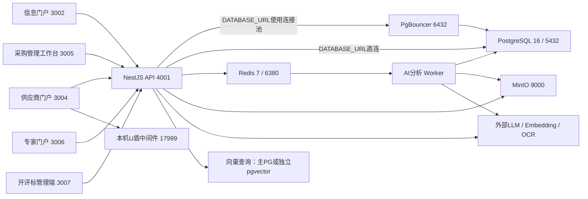

# 智慧水发·蜀水云采 ERP 系统

文档日期：2026-10-08

## 1. 项目概况

智慧水发·蜀水云采 ERP 系统面向采购单位、供应商、评标专家、开评标主持人和系统管理员，覆盖采购项目准备、公告发布、投标递交、开标、评标、结果发布、合同履行和归档，同时提供供应商库、专家库、工作协同和智能辅助功能。

### 1.1 交底范围统计

本交底包括信息门户、供应商门户、采购管理工作台、专家门户、开评标管理端及相关后台服务。以下数量按附件列示范围统计。

| 项目 | 数量 | 统计范围 |
| --- | ---: | --- |
| 资料所列前端应用 | 5 | public、supplier、web、expert、bid |
| NestJS 控制器文件 | 56 | 附件接口对应的控制器文件 |
| HTTP 路由声明 | 798 | Get、Post、Put、Patch、Delete等HTTP方法装饰器 |
| Prisma 模型 | 134 | 附件列示的模型；物理分区表和迁移管理表另计 |
| Prisma 字段声明 | 2,013 | 附件列示的数据字段和关系字段 |
| Prisma 枚举 | 31 | 148个取值，不含以String/Json存储的业务状态 |
| 直接依赖声明 | 210 | JavaScript/TypeScript 199条，Python 11条 |
| 功能组 | 131 | 前端78组、后台53组，包含前后端对应关系 |
| 前端页面声明 | 93 | 本资料保留页面中的page.tsx，包含兼容重定向页 |

## 2. 系统架构与角色分工

### 2.1 部署与数据流

前端通过fetch、共享客户端或各端包装器调用API；多数`/api/*`请求由Next.js rewrites/proxy转发。实时通信采用Socket.IO，反向代理接入包含WebSocket Upgrade转发。各Next.js应用独立构建，页面组件保留在各自应用内。

共享包包括`config`（端口与门户路由）、`shared`（领域类型与常量）、`client`（API客户端）和`ukey`（国密与信封处理）。`packages/ui`当前没有package.json及可消费的共享组件包。

### 2.2 角色与门户

| 角色 | 主要职责 | 入口与会话 | 访问条件 |
| --- | --- | --- | --- |
| 匿名访客 | 公告、平台信息、注册入口 | :3002 | 普通公开内容允许匿名访问；定向公告和受控附件另有授权条件 |
| supplier | 企业资料、投标、开标响应、澄清回复、结果查询 | :3004；token_supplier；X-Supplier-Token | 受供应商状态、邀请范围、文件归属和业务时间窗限制 |
| staff | 日常项目准备、公告、供应商及专家业务办理 | :3005；token_web；X-Web-Token | 部分驾驶舱和汇总页限定leader/admin；导航受账号配置控制 |
| leader | 采购统筹、汇总查看、项目管理与审批 | :3005；token_web | 按模块适用公司范围或个人项目范围 |
| admin | 账号、配置、跨公司管理、加密证书与运行管理 | 工作台入口使用token_web；现场入口使用token_bid | 登录落地与cookie由来源门户及角色配置决定 |
| bid_host | 被指派项目的现场开标与评标组织 | :3006登录后分流至:3007；token_bid | 按项目指派及现场操作权限访问 |
| bid_expert | 受邀或指派项目的核验、评审、打分、报告确认 | :3006；token_expert | 受评标室口令、登录窗口、签到、回避、工位会话和结果状态限制 |

用户角色存储于`User.role`（String）。上述角色为当前活跃门户使用的业务角色。`:3006`同时提供专家和内部人员登录分流，专家评审权限与项目指派关系关联。

实现位置：`apps/api/src/auth/{portal-cookie,port-roles,port-routes,auth.guard}.ts`、`apps/api/src/common/guards/roles.guard.ts`、`apps/api/src/auth/auth.controller.ts`、`packages/config/src/urls.ts`。

### 2.3 办公室与现场分工

| 阶段 | 工作台 :3005 | 现场 :3007 | 供应商 :3004 / 专家 :3006 |
| --- | --- | --- | --- |
| 开标前 | 项目与公告、供应商及专家确认、评分标准、主持人指派、按时开标、延期及流标处理 | 接收被指派任务 | 供应商获取文件并投标；专家响应邀请 |
| 开标中 | 查看进度和监督信息 | 组建会话、组织解密、唱标、确认、异议处理、会场交流、开标资料移交 | 供应商解密、确认或提出异议 |
| 评标中 | 查看进度 | 启动评标、设置时限、跟踪专家进度、组织澄清及动议、生成结果和签字材料 | 专家独立评审；供应商应邀澄清及参与适用的多轮报价 |
| 评标后 | 接收回流、完整归档、公示、通知书、合同及履约管理 | 签字登记、回流材料生成、档案查阅 | 供应商查看结果、签收通知和履约；专家查看评审记录 |

门户分工由界面入口、门户路径白名单和服务端权限分别控制。

## 3. 技术栈、中间件与运行依赖

### 3.1 部署单元与启动关系

| 单元 | 源码/命令 | 端口 | 根dev包含 | 运行方式 |
| --- | --- | ---: | --- | --- |
| 信息门户 | apps/public-portal / dev:public | 3002 | 是 | Next App Router |
| 供应商门户 | apps/supplier-portal-next / dev:supplier | 3004 | 是 | Next |
| 采购工作台 | apps/web / dev:web | 3005 | 是 | Next；start脚本为next start，未指定PORT或-p参数时使用默认端口3000 |
| 专家门户 | apps/expert-portal / dev:expert | 3006 | 是 | Next；predev/prebuild复制MediaPipe资源 |
| 开评标门户 | apps/bid-portal / dev:bid | 3007 | 是 | Next |
| API | apps/api / dev:api | 4001（PORT可覆盖） | 是 | Nest watch模式 |
| AI Worker | apps/api/src/ai-bid-analysis-worker.ts | 无HTTP端口 | 是 | dev:ai-worker等待20秒后执行nest build并启动Node进程，不启用watch；队列消费由独立Worker承担 |
| U盾模拟中间件 | services/ukey-middleware | 17999，默认127.0.0.1 | 通过guard启动 | 位于浏览器使用者本机；不在pnpm workspace内，使用独立npm锁文件，首次启动执行npm install |
| OCR | services/ocr | 8100，默认127.0.0.1 | 否 | pnpm dev:ocr启动；首次创建venv并通过pip安装依赖；hybrid子进程默认使用5002/5003 |
| Embedding/vLLM | 外部服务 | 由配置决定，源码默认8001/v1 | 否 | 应用提供HTTP调用和探测客户端，仓库不包含该服务镜像及部署编排 |

### 3.2 软件版本与接入范围

| 分类 | 锁文件解析版或版本依据 | 接入范围 |
| --- | --- | --- |
| Node.js / pnpm | CI指定Node24；根packageManager为pnpm10.33.0 | 仓库engines未固定Node小版本 |
| 语言与构建 | TypeScript/JavaScript、Python、SQL、HTML/CSS；Next默认Turbopack | Node承载前后端及U盾服务；Python承载OCR和辅助文档脚本；pnpm工作区管理JS依赖 |
| Docker / Compose | 镜像标签见下节；Docker Engine/Compose运行版未锁定 | compose编排基础设施，未包含全部业务服务的生产容器编排 |
| Next / React / ReactDOM | 16.2.3 / 19.2.4 / 19.2.4 | 本资料所列5个门户版本一致 |
| Tailwind CSS / PostCSS插件 | 4.3.0 / 4.3.0 | 本资料所列5个门户均声明；各门户UI依赖不同 |
| TypeScript | API及常规前端5.9.3；根/client/config6.0.3 | package声明范围与锁文件解析版分列；shared/ukey未直接声明TS，使用workspace工具 |
| Nest core/common/platform-express | 11.1.24 | API；websockets/platform-socket.io为11.1.26 |
| Nest config/swagger/schedule/event-emitter | 4.0.4 / 11.4.4 / 6.1.3 / 3.1.0 | app.module、main及各scheduler |
| Express / Prisma及client | 5.2.1 / 6.19.3 | Nest HTTP；PrismaService启动时执行$connect；schema provider为postgresql |
| BullMQ / nestjs-bullmq / ioredis | 5.79.1 / 11.0.4 / 5.11.1 | API入队、独立Worker消费、Redis业务状态及缓存 |
| Socket.IO / socket.io-client | 4.8.3 / 4.8.3 | API的3个网关；供应商、工作台、专家、开评标4个门户声明客户端 |
| sm-crypto | 0.4.0 | API、ukey共享包及模拟中间件；以软件实现SM2/SM3/SM4，生产CA/HSM尚未接入 |
| MinIO / pg | 8.0.7 / 8.23.0 | S3客户端；VectorDbService的独立pg连接池 |
| 文档/文件 | docx9.7.1、exceljs4.4.0、mammoth1.12.0、pdf-parse1.1.4、jszip3.10.1、multer2.2.0 | API使用docx/mammoth/pdf-parse/jszip/multer处理采购文档及文件；工作台使用exceljs导出供应商资料和遴选名单；系统级转换工具见 3.4 节 |
| 认证/安全 | bcryptjs3.0.3、passport0.7.0、passport-jwt4.0.1、nestjs-jwt11.0.2、helmet8.3.0、throttler6.5.0、sanitize-html2.17.6 | main、auth及安全工具函数 |
| 校验 | class-transformer0.5.1、class-validator0.14.4 | API全局ValidationPipe及DTO |

| UI/交互 | lucide-react1.17.0、motion/framer-motion12.40.0 | 对应门户使用；web另声明radix-ui1.6.0、shadcn4.12.0、zod4.4.3，声明与源码使用范围见 3.7 节 |
| 专家视觉 | @mediapipe/tasks-vision1.0.1 | signin-camera.tsx、copy-mediapipe.mjs；提供浏览器本地人脸检测，不包含外部身份真实性核验服务 |
| 测试 | Jest30.4.2、ts-jest29.4.11、Supertest7.2.2、Playwright1.61.1 | Jest/Supertest配有可执行套件；Playwright为web开发依赖，仓库未配置Playwright及其测试用例 |

JS依赖解析版本来自 `pnpm-lock.yaml` 的importers。Python运行时的最低版本及精确版本未统一锁定。Python依赖中，FastAPI0.115.12、uvicorn0.34.2、python-multipart0.0.20、pdf2image1.17.0采用精确版本声明；Pillow声明版本下界，rapidocr_onnxruntime、numpy、opendataloader-pdf[hybrid]、PyMuPDF、python-dotenv及可选easyocr未锁定精确版本。U盾中间件使用 `services/ukey-middleware/package-lock.json`，其中sm-crypto为0.4.0。

### 3.3 基础设施与数据流

- **主库**：compose镜像为 `pgvector/pgvector:pg16`，宿主端口5432，PG的max_connections为200；Prisma业务数据默认使用此库。镜像按标签引用，未固定PG补丁版本或pgvector扩展精确版本。

- **PgBouncer**：镜像为 `water-erp-pgbouncer:local`。Dockerfile基于alpine3.20，通过apk安装pgbouncer，未固定该包版本。监听6432，使用transaction连接池及SCRAM认证，max_client_conn为200、default_pool_size为25、reserve_pool_size为5。DATABASE_URL指向6432时API经连接池访问数据库；directUrl用于CLI迁移。仓库配置文件包含开发环境连接配置，未提供独立生产配置。

- **Redis**：compose镜像为 `redis:7-alpine`，端口6380→6379，启用AOF持久化。用途包括BullMQ、AI缓存、验证码发送频控及冷却、验证次数和Lua原子消费、专家工位迁移ticket及状态、焦点确认、U盾绑定PoP nonce。部分缓存错误被捕获并降级；依赖Redis保存业务状态的功能在连接失败时受影响。`apps/api/src/redis/redis.module.ts`支持REDIS_URL或REDIS_HOST/REDIS_PORT；Bull配置仅读取REDIS_URL，HOST/PORT配置不改变队列连接。

- **MinIO/S3**：compose镜像为 `minio/minio:latest`，端口9000/9001；保存投标文件、密文、标书、AI报告、签字包、监督导出和日志归档。客户端及文件操作位于 `apps/api/src/upload/minio.client.ts`、`apps/api/src/storage/storage.service.ts`、`apps/api/src/bid/bid-decrypt.service.ts`、`apps/api/src/bid-backup/bid-backup.service.ts`，ensureBucket负责创建桶。CI在MinIO镜像不可用时使用SeaweedFS4.48作为S3冒烟测试替代；应用compose仍使用MinIO。

- **独立向量库**：compose的pgvector服务属于vector-sidecar profile，执行 `docker compose --profile vector-sidecar up -d pgvector` 后启用宿主端口5434。`VectorDbService`按VECTOR_DATABASE_URL→DIRECT_URL→DATABASE_URL选择连接，pg连接池max为5。`VectorInitService`在PGVECTOR_ENABLED严格为true时创建vector扩展、DocumentChunk表、vector(1024)字段和HNSW索引。该变量仅控制初始化，查询及写入由各业务调用路径执行。`VectorSearchService`采用cosine距离。

- **Elasticsearch**：活跃应用、共享包、辅助服务依赖及compose未接入Elasticsearch。全局搜索 `apps/api/src/search/search.service.ts`使用Prisma的findMany/contains查询。

### 3.4 AI、OCR、U盾和外部业务服务

#### 3.4.1 AI/知识库

- `LlmService`通过HTTPS调用DeepSeek `/chat/completions`。DEEPSEEK_API_KEY缺失时，调用返回503。默认进程内并发为10，重试次数为2；429、5xx、网络错误及超时采用退避重试。供应商评价、画像和遴选在LLM调用失败时可降级至规则引擎，dashboard摘要调用失败时抛错。实现位于 `apps/api/src/local-ai/llm.service.ts`、`apps/api/src/ai/supplier-evaluation-analysis.service.ts`、`apps/api/src/ai/supplier-portrait-analysis.service.ts`、`apps/api/src/ai/supplier-selection-ai.service.ts`、`apps/api/src/ai/ai.service.ts`。

- `LlmService`使用https.request并固定端口443，未实现任意HTTP协议或自定义端口的本地LLM调用。`VllmMonitorService`通过LLM_BASE_URL和LLM_MODEL探测本地LLM，其探测配置独立于LlmService的DeepSeek推理调用。

- Worker不监听HTTP端口，注册3个Bull队列名，配置TenderProcessor和BidderProcessor两类消费者；API主进程负责入队。AI分析依赖Redis、主库、MinIO文件及报告存储和LLM；扫描文件解析另依赖OCR。

- Embedding每批最多32条，调用OpenAI兼容的 `/embeddings`。探测状态不可用时返回503。RAG审查中的向量检索错误由semantic/general reviewer捕获，审查改为不带RAG上下文，相关语义规则的效果受限。知识库上传时，embedding失败会报错；vector insert失败则保留KnowledgeFile并记录日志。

- API与Worker各自持有进程内LlmSemaphore，并发限制不跨进程共享。

#### 3.4.2 OCR与文档工具

- `OcrService`支持OCR_SERVICE_URL逗号列表，按round-robin分发请求，并对大文件分批、重试。健康探测可访问多个副本；请求分发未实现故障节点自动剔除。

- Python服务提供 `/ocr` 和 `/health`。未配置引擎时默认使用rapid；环境模板选择opendataloader，PDF先解析文本，扫描件转为hybrid处理。本地存在PP-OCRv5模型文件时使用v5，否则使用v4。EasyOCR通过额外依赖安装启用，支持CPU/GPU。每组hybrid子进程占用独立端口段，端口重叠会产生启动冲突。

- `/health`返回ok并附hybrid状态及worker数量；hybrid启动异常会被记录，健康端点仍可响应HTTP200。

- `apps/api/src/ai-bid-analysis/utils/file-processor.ts`直接读取txt/md/csv，以mammoth解析docx；PDF优先通过系统工具 `pdftotext` 提取文本，文本不足或工具不可用时转为OCR；图片使用OCR。数字PDF文本提取及DOCX解析可独立于OCR完成。

- LibreOffice用于旧DOC转文本、专家文档转PDF、Word上传转换和签字包PDF生成。转换失败时，部分路径保留原格式，签字包回退为DOCX。实现位于 `apps/api/src/common/office-to-pdf.util.ts`、`apps/api/src/knowledge/services/document-parser.service.ts:187`、`apps/api/src/expert/expert.service.ts:909`、`apps/api/src/bid/bid-sign-packet.service.ts:592`。

- seed通过Python3/reportlab生成演示PDF；工具不可用时跳过相应文件生成及上传。该调用独立于OCR虚拟环境，位于 `apps/api/prisma/seed.ts:211` 起的文档生成逻辑。

#### 3.4.3 U盾/证书

- `packages/ukey`共享SM2 C1C3C2、SM3签名杂凑及SM4-CBC实现；MockUKey使用PBKDF2和AES-GCM保护软件介质，canonical SHA256通过WebCrypto计算。相关浏览器操作依赖HTTPS或localhost安全上下文。

- `VendorUKeyAdapter`对接本机演示协议 `http://127.0.0.1:17999`，尚未接入真实厂商SDK或生产CA。

- 中间件支持盾文件、PIN会话、错误锁定及PUK、插拔检测，并提供portable Linux/Windows启动脚本。USB盘作为软件盾文件载体。根dev通过USB guard启动；USB模式所指向的slots挂载目录缺失时，启动脚本退出。

- 生产CA及HSM不在现有编排中。管理方私钥存储于ADMIN_KEYSTORE_DIR，监督签名私钥存储于SUPERVISION_KEYSTORE_DIR。系统包含X509及信任锚框架；`apps/api/src/common/crypto/x509/revocation.ts`的默认空撤销provider返回未吊销状态，未完成在线CRL/OCSP撤销查询接入。

#### 3.4.4 通知

- 验证码：`apps/api/src/verification/sms-provider.ts`实现HTTP通用网关、采用ACS3签名的阿里云Dysmsapi调用及console开发模式。发送异常返回SMS_PROVIDER_FAILED并回滚验证码；production禁止console模式及debug绕过。

- 通知中心：`apps/api/src/notification/channels/sms.channel.ts`和 `apps/api/src/notification/channels/phone.channel.ts`为占位实现，返回skipped，与验证码发送通道独立。邮件通过nodemailer连接SMTP，未配置时返回skipped，配置后按投递结果返回sent或failed。

### 3.5 备份恢复范围

- `pnpm db:backup`通过Docker exec在PG容器中执行 `pg_dump --clean --if-exists`，以gzip压缩后写入backups，默认保留14天。脚本使用PG_CONTAINER、DB_USER、DB_PASS、DB_NAME、BACKUP_KEEP_DAYS，不读取DIRECT_URL。备份范围为主数据库，不包含MinIO、本地PMI附件及历史版本、Redis、sidecar、私钥目录或KMS配置。

- `pnpm db:restore <file> [db]`在5秒等待后执行恢复，跳过已知的分区继承约束DROP错误，其他ERROR返回失败。恢复默认库后自动执行 `verify-encrypted-assets.js`，检查数据库记录与当前MinIO密文的匹配关系；恢复非默认目标库时不执行该加密对象校验。

- 系统持久化资产分布于主库、对象存储、API工作目录下的 `uploads/project-management` 及其历史版本、ADMIN_KEYSTORE_DIR、SUPERVISION_KEYSTORE_DIR、KMS_SECRET配置和向量库。现有数据库脚本未提供上述资产的联合一致性备份、定时调度、异地副本或RTO/RPO测量。

- operation-log向MinIO归档与业务库备份相互独立。compose未配置15年保留锁、WORM对象锁或存储生命周期策略。

### 3.6 自动化测试与健康检查

- API命令 `pnpm --filter api test`使用Jest，roots包含src及scripts；test:cov提供覆盖率统计。test:e2e的maxWorkers为1、timeout为60秒，并启用forceExit；执行过程中创建和删除测试数据。

- 前端及共享包：supplier使用tsx node:test运行lib/components/utils测试；expert提供node --test脚本；shared使用tsx node:test；client先build再执行node test.cjs；U盾中间件独立执行node --test。web包含若干.test.ts文件，但package未配置test脚本；Playwright仅列为开发依赖，未配置浏览器E2E套件。

- OCR：test_main.py使用unittest及mock；test_ocr.py和benchmark_workers.py分别用于文档OCR及性能测试，依赖本地环境和输入文件，未纳入主CI。

- GitHub CI位于仓库根 `/home/asus/桌面/ERP/.github/workflows/ci.yml`。validate作业使用Node24和pnpm10，执行frozen-lockfile安装、4个共享包构建、Prisma生成及验证、API与本资料所列5个门户的tsc、API eslint、cgzxui red-card检查，以及API/shared/supplier单测。作业不包含本资料所列门户的生产next build。

- e2e作业使用PG16及vector、Redis7、S3服务；MinIO镜像不可用时回退SeaweedFS4.48。执行内容包括新库migrate deploy及status、API构建、docs200启动检查、reportlab安装、seed、API启动、Jest集成测试、dual-selfcheck、new-track脚本、RolesGuard抽检及legacy快照回归。

- CI未启动AI Worker、OCR、Embedding、短信外部服务或CA，也未配置DeepSeek key。`ai-bid.e2e-spec.ts`接受201/400，部分用例依种子条件跳过或基于已有报告断言；测试范围不包含模型输出质量及完整异步分析链路。

- `/api/health`以JSON的status及checks返回数据库和Redis状态，HTTP200响应中可包含degraded。`/api/docs`是非生产HTTP/Swagger端点。系统管理health、OCR `/health`、文件读写及Worker任务状态由各自接口或业务流程提供。

### 3.7 声明依赖、终端资源与并发配置

`web`声明或配置radix-ui、shadcn、zod、class-variance-authority、@hookform/resolvers；`apps/web/src`没有对应包的import。react-hook-form在登录页面使用。依赖版本CSV分别列出依赖声明和锁文件解析版本。

专家端MediaPipe WASM通过 `apps/expert-portal/scripts/copy-mediapipe.mjs` 从node_modules复制，模型随仓库分发；当前检测路径不依赖运行时CDN。`AI_BID_WORKER_CONCURRENCY`仅作用于BidderProcessor，默认值为2。LLM默认并发10为进程内限制，各API及Worker进程分别计数。

## 4. 数据库、文件存储与核心实体

### 4.1 数据持久化分工

业务主库采用 PostgreSQL 协议，Prisma provider 为 `postgresql`；默认 Compose 使用带 pgvector 扩展的 PostgreSQL 16。`DATABASE_URL` 用于业务连接，`DIRECT_URL` 用于迁移直连，PgBouncer 连接路径由实际 URL 决定。独立向量侧库承载向量数据，业务数据保存在主库。Redis 承载队列和临时业务状态，MinIO 保存对象文件，PMI 阶段附件及其历史版本还使用本地文件存储。持久化资产包括数据库、对象文件、本地附件、私钥及相关配置。

数据库清单列出本交底范围内的 134 个 Prisma 模型和 2,013 个字段声明。运行库另有迁移管理表、分区子表、扩展对象及独立向量表等对象；Prisma 关系字段不对应独立物理列。附件 02、03、04 分别列出模型、字段和枚举，物理结构由目标库 DDL、索引、约束及迁移状态共同确定。

### 4.2 数据域与代表实体

| 数据域 | 核心实体 | 关系与数据约束 |
| --- | --- | --- |
| 组织账号 | Company、Department、User、RegistrationReview、UserSettings、UserDraft | 公司主数据、角色、账号激活/冻结、用户名与角色唯一约束、会话状态、默认落地 |
| 供应商 | Supplier、SupplierApprovalRecord、SupplierContact、SupplierQualification、SupplierBankAccount、SupplierPerformance、SupplierChangeRecord、SupplierEvaluation、SupplierPenalty | 注册三级审核、企业子项、变更审批、分类标签、资质有效期、状态与账号一致性 |
| 专家库 | ExpertProfile、ExpertEvaluation、ExpertCert、BidExpert | 专家本体、项目指派、正选/候补、组长、可用状态、公司归属、签到/报告 |
| 项目管理 | ProjectManagementItem、ProjectManagementStage、ProjectPlanItem、ProjectTeamMember、ProjectTenderDraft/Version、StageComplianceRule | 个人归属、阶段与方式、计划审批、正式文件指针、版本/冻结、轮次 |
| 台账与旧立项 | Project、ProcurementRound、RoundParticipant、ProcurementProject | 台账、PMI、招标项目分别存储；procurement 兼容接口仍在模块中装配 |
| 招投标核心 | BidProject、BidSupplier、SupplierBidSubmission、InvitationRsvp、BidFileBackup | 一个项目多个投标人；草稿/递交唯一性、撤回、信封版本、文件归属、邀请关系 |
| 开标与保证金 | BidOpeningSession、BidOpeningRecord、BidBondLedger、OpeningHallMessage/ReadCursor | 时间窗、解密/确认状态、金额单位、保证金登记、公共/私密会场 |
| 评分与议事 | BidScoreItem/Point/Record/RecordHistory/Delta/Review/PointDecision、BidRequirementReview、ExpertMemo、ExpertDispute、BidClarification、BidMotion、BidVote | 标准/得分点/草稿/正式得分、版本冲突、历史、澄清与动议、投票唯一性 |
| 结果报价签字 | BidEvaluationResult、BidRound、BidQuote、BidSignPacket、AwardLetterDelivery | 报价轮状态、最终结果、签字闭环、回流文件、通知版本与签收 |
| 公告与文件获取 | Announcement、AnnouncementHistory、AnnouncementAttachment、BidDocument、BidDocumentAccess、TenderClarification/Doc/Receipt | 公开/定向、发布/下线/回收站、授权下载、获取记录、澄清版本 |
| AI知识/审查 | AiBidAnalysisTask、AiBidderResult、AiConcordanceResult、AiBidReport、KnowledgeBase/File、DocumentChunk、ReviewTask、ComplianceRule、ExtractionTask、TenderFieldSample | 异步阶段、真实/降级来源、文档分块和向量一致、结果与源文件版本对应 |
| 档案与文件 | FileAsset、Attachment/Version、BidArchiveItem、ArchiveScopeItem、ArchiveMetadata、ArchiveCheckResult、ArchiveTransfer | MinIO与本地双源、哈希、目录范围、检测结果、移交扫描、保管期限 |
| 协同与审计 | WorkArrangement及Note/Template/Dependency、Notification/DeliveryLog、ChatMessage、AuditLog、OperationLog/Archive、SupervisionPushLog、PlatformPushLog | 任务依赖、个人归属、通知结果、请求审计与业务审计分开、报送回执 |
| 加密与系统配置 | SupplierCert、AdminEncryptionCert、ExpertCert、SystemConfig、BadgeDefinition、UserBadge | 数据库存储证书、状态、公钥与引用；私钥存储在独立介质或目录，与数据库分开保存 |

### 4.3 Schema枚举取值

| 枚举 | 值 |
| --- | --- |
| `BidStage` | DOWNLOAD, SUBMIT, OPENING, EVALUATING, ARCHIVED, ABORTED |
| `DecryptStatus` | PENDING, RUNNING, SUCCESS, DANGER |
| `ConfirmStatus` | CONFIRMED, PENDING, EXCEPTION, DISPUTED |
| `ScoreCategory` | QUALIFICATION, RESPONSIVE, BUSINESS, TECHNICAL, PRICE |
| `ArchiveStatus` | ARCHIVED, PENDING_CONFIRM, NOT_STARTED |
| `OpeningHallRoomType` | PUBLIC, PRIVATE |
| `OpeningHallSenderRole` | HOST, SUPPLIER, SYSTEM |
| `OpeningHallMessageType` | TEXT |
| `AiAnalysisTaskStatus` | PENDING, TENDER_PROCESSING, ANALYZING, COMPLETED, COMPLETED_WITH_ERRORS, FAILED, CANCELLED |
| `AiBidderStatus` | PENDING, OCR_PROCESSING, OCR_COMPLETED, EXTRACTING, EXTRACTED, CONCORDANCE_CHECKING, SCORING, SCORED, DEVIATION_ANALYZING, COMPLETED, FAILED |
| `ExpertLevel` | A, B, C, D, E |
| `TagStatus` | PENDING, APPROVED, REJECTED |
| `SupplierStatus` | PENDING, RETURNED, APPROVED, REJECTED, DISABLED, BLACKLIST |
| `InvitationStatus` | ACTIVE, USED, EXPIRED, REVOKED |
| `ChangeStatus` | PENDING, APPROVED, REJECTED |
| `AnnouncementType` | BID_NOTICE, ADDENDUM, PREQUAL_NOTICE, PRE_WIN_NOTICE, WIN_NOTICE, CONTRACT_NOTICE, PERFORMANCE_NOTICE, POLICY, PLATFORM, FAILED_BID_NOTICE, WIN_BID_NOTICE, CLARIFY_NOTICE |
| `AnnouncementStatus` | DRAFT, PUBLISHED, ARCHIVED, HIDDEN, OFFLINE |
| `ProcurementStatus` | DRAFT, PENDING_REVIEW, APPROVED, REJECTED, BIDDING, CONTRACTED, CLOSED |
| `ResultStatus` | AWARDED, FAILED_REVIEW, FILE_REVISION_REQUIRED, INVALID_RESPONSE, PENDING, CANCELLED |
| `SourceType` | EXCEL_IMPORT, MANUAL, PROJECT_MANAGEMENT |
| `AttachmentType` | TENDER_DOCUMENT, REVIEW_COMMENT, BID_ANALYSIS, AWARD_NOTICE, CONTRACT, SUPPORTING_MATERIAL |
| `PasswordChangeRequestStatus` | PENDING, APPROVED, REJECTED |
| `ProjectManagementStatus` | ACTIVE, ARCHIVED, RECYCLED, TERMINATED |
| `ProjectStageStatus` | NOT_STARTED, IN_PROGRESS, COMPLETED |
| `WorkArrangementStatus` | TODO, IN_PROGRESS, BLOCKED, COMPLETED, CANCELLED |
| `WorkArrangementType` | APPROVAL, FOLLOW_UP, WRITING, COMMUNICATION, REVIEW, ARCHIVE, RESEARCH, MEETING, OTHER |
| `WorkArrangementUrgency` | LOW, MEDIUM, HIGH, CRITICAL |
| `WorkArrangementRecurrence` | NONE, DAILY, WEEKDAYS, WEEKLY, MONTHLY |
| `WorkArrangementNoteType` | PROGRESS, INSIGHT |
| `ArchiveRetentionPeriod` | PERMANENT, Y30, Y10 |
| `SignStatus` | PENDING, SIGNED, REFUSED_DISSENT, DEEMED_AGREED |

### 4.4 隔离与授权实现

1. 全局 Guard 顺序：AuthGuard→PortRouteGuard→RolesGuard→ThrottlerGuard。鉴权默认拒绝未声明角色；显式 `@Public` 跳过认证/角色检查（门户路径与限流守卫仍独立运行），`@AnyRole` 要已登录，`@Roles` 匹配角色，`@OptionalAuth` 是额外例外（无 token 匿名可进入、无角色元数据时可放行；带了无效 token 仍失败）。全局 DTO whitelist/transform、CookieParser、Helmet、非生产 Swagger；非生产 CORS 允许任意来源，生产按配置名单。代码入口：`apps/api/src/app.module.ts`、`main.ts`、`auth/auth.guard.ts`、`common/guards/roles.guard.ts`。

2. 本资料涉及六种业务角色：`admin`、`leader`、`staff`、`bid_host`、`bid_expert`、`supplier`。`procurement_staff` 不是此处有效角色全集中的值。数据库 User.role 是 String。

3. token 读取顺序：`X-Web-Token` / `X-Supplier-Token`→按门户命名 cookie→旧 `token`。门户识别顺序 `X-Portal`→Origin/Referer端口→未识别。缺少 X-Portal 时，仍可通过 Origin/Referer 推断门户；无门户信息时保留旧 token cookie 回退。代码入口：`apps/api/src/auth/portal-cookie.ts`。

4. 命名空间：token_public、token_web、token_supplier、token_expert、token_bid；它们是 localhost 跨端口 cookie 的命名隔离，不是浏览器按端口物理隔离。admin从web入口写token_web，非web登录按落地改写token_bid；专家入口允许内部角色登录分流，不仅bid_expert。角色入口允许集合见 `port-roles.ts`，路由独占名单见 `port-routes.ts`。

5. `sid` 与 `User.webSessionId` 复查用于web/supplier/expert设备会话替换；token带sid即校验，冻结/停用即时拒绝。供应商支持 X-Supplier-Token 标签页令牌，cookie 作为回退来源。

6. 公司域：CompanyScopeService 对 admin 默认all、可切单公司，非admin强制数据库当前companyId、无归属给永假范围；filter/assertInScope/stampFor 由各模块主动调用。PMI/案卷主要按createdBy个人隔离，admin例外；项目计划review对leader有审他人计划例外。bid管理接口另挂BidCompanyScopeGuard，现场bid门户被指派人可执行跨公司指派项目，其余内部角色按公司；列表另在service过滤。

7. 公司过滤按模块实现：prequal/framework 仅在创建时 stamp 公司，list/get/decide 等路径未传入 scope；performance 指标/列表未传入公司 scope；workflow 聚合按角色选择来源，查询未附加公司 where。合同域向列表、详情和操作显式传入 scope。对应实现位于各模块 controller/service。

8. 非 HTTP：bid、chat、notification 的 WS 握手和房间订阅使用各自的会话与订阅鉴权，不自动继承 HTTP guards。文件和下属资源的访问条件涉及父对象授权、文件引用关系、导出权限及预签名链接有效期。

### 4.5 审计、分区与持久化机制

`OperationLog` 按月 RANGE 分区，默认在线保留 180 天，并预建未来分区。月分区默认先归档至 MinIO gzip JSONL、写入 SHA-256 清单，再删除分区；归档失败时保留该分区。`OPERATION_LOG_ARCHIVE_ENABLED=false` 时跳过归档并直接删除；`purgeDefaultStragglers()` 对 DEFAULT 分区的过期记录执行分批 DELETE。`AuditLog` 为独立的低频业务审计表，默认保留 5,475 天。默认 Compose 未声明 WORM 或对象保留锁配置。

请求日志由 interceptor 记录，guard 在其之前执行；鉴权拒绝与接口内失败采用不同的记录路径，部分请求路径位于日志排除清单。日志处理包含密码、token 等敏感字段脱敏，归档文件支持哈希一致性校验。

数据库迁移文件按顺序执行。数据库层涉及存量升级、唯一与外键约束、事务并发、关联删除、分区与索引、金额精度及单位、日期及时区、JSON 扩展字段；文件元数据保存在数据库，文件内容分别位于对象存储和本地目录。

## 5. 功能清单

功能清单按门户和后台业务域组织。功能编号与附件功能矩阵对应，前端与后台功能按各自入口列示。

### 5.1 页面入口数量与访问边界

| 编号 | 活跃端 | 端口 | `page.tsx` 数 | 用户与入口 | 代码位置 |
| --- | --- | ---: | ---: | --- | --- |
| ROUTE-01 | 信息门户 `public-portal` | 3002 | 10 | 面向公众提供公告、集团信息和跨端入口；保留 `/login`、`/register` 简版页面 | `apps/public-portal/src/app/` |
| ROUTE-03 | 供应商门户 `supplier-portal-next` | 3004 | 26 | 面向 supplier；正式与临时供应商菜单不同；包含根入口和开标确认兼容跳转页 | `apps/supplier-portal-next/src/app/`、`src/components/shell/supplier-menu.ts` |
| ROUTE-04 | 工作台 `web` | 3005 | 42 | 面向内部采购管理；入口由角色和用户工作台配置控制。驾驶舱 `/dashboard`、`/procurements`、`/progress` 仅限 leader/admin，其他角色跳转工作安排 | `apps/web/src/lib/login/login-routing.ts`、`src/components/app-shell.tsx` |
| ROUTE-05 | 专家门户 `expert-portal` | 3006 | 11 | 面向 bid_expert；登录页提供专家和管理员入口，管理员入口转开评标端；支持平板和工位认领 | `apps/expert-portal/src/app/login/page.tsx`、`src/proxy.ts` |
| ROUTE-06 | 开评标管理端 `bid-portal` | 3007 | 4 | proxy 允许 admin/bid_host/leader/staff 访问；主持操作另设角色权限 | `apps/bid-portal/src/proxy.ts`、`src/components/opening-hall.tsx` |

### 5.2 信息门户（3002）

| 编号 | URL / 功能组 | 详细功能与操作 | 数据与限制 | 代码位置 |
| --- | --- | --- | --- | --- |
| PUB-01 | `/` 公开首页 | 轮播宣传内容、按类型分组公告、焦点公告、标题检索、查看全部、回到顶部；跨端进入采购管理、供应商、专家/开评标入口 | 公告首屏由服务端按类型取数，客户端定时刷新；首页请求异常支持重试，仅保留标题的公告不开放正文入口 | `apps/public-portal/src/app/page.tsx`、`home-client.tsx`、`src/lib/announcements.ts` |
| PUB-02 | `/announcements` | 公告类型筛选、标题/编号关键词检索、数量指标、公告列表进入详情 | 客户端读取前100条公告；“本月发布”据此前100条统计，月内公告超过100条时为下限值。API失败时使用本地 `ANNOUNCEMENTS` 数组 | `apps/public-portal/src/app/announcements/page.tsx`、`src/lib/announcements.ts` |
| PUB-03 | `/announcements/[id]` | 正文、结构化采购信息、AI 摘要、联系方式、从首页/列表进入后的返回位置 | API失败时按ID查询本地公告；本地未命中时显示加载或下线错误 | `apps/public-portal/src/app/announcements/[id]/page.tsx` |
| PUB-04 | `/procurement-portal` | 采购全流程图谱、采购工作台登录链接 | 展示九阶段采购流程并提供工作台入口；无本页发起采购操作，图谱不含直接采购备案阶段 | `apps/public-portal/src/app/procurement-portal/page.tsx` |
| PUB-05 | `/bidding-hall` | 供应商投标流程图谱、注册和登录供应商门户 | 展示投标流程并提供供应商入口；在线开标大厅位于3004和3007 | `apps/public-portal/src/app/bidding-hall/page.tsx` |
| PUB-06 | `/about`、`/contact` | 集团简介、固定联系信息、跳转来访接待 | 固定内容展示，无内容管理提交操作 | `apps/public-portal/src/app/about/page.tsx`、`contact/page.tsx` |
| PUB-07 | `/contact/visitor` | 姓名、电话、单位、人数、来访日期、事由、备注的前端校验和提交按钮 | 登记接口未接通；提交仅等待800ms后提示成功，不保存登记数据或向后台发送通知 | `apps/public-portal/src/app/contact/visitor/page.tsx`（`handleSubmit`） |
| PUB-08 | `/login`、`/register` | 简版登录调用 `/auth/login` 按角色分流；简版注册调用 `/supplier/register` | 3002注册表单未提交DTO必填的registrationPhone、registrationCode和companyId，与现行注册接口字段要求不匹配；正式注册入口为3004，首页注册弹窗同样保留简版字段 | `apps/public-portal/src/app/login/page.tsx`、`register/page.tsx` |

### 5.3 供应商门户（3004）

| 编号 | URL / 功能组 | 详细功能与操作 | 关键前置、边界与跨端协同 | 代码位置 |
| --- | --- | --- | --- | --- |
| SUP-01 | `/login`、`/` | 登录、错误/待审/过期提示、密码重置申请；根路由跳转工作台 | 客户端使用sessionStorage和 `X-Supplier-Token`；无标签页token时回退到cookie | `apps/supplier-portal-next/src/app/login/page.tsx`、`src/lib/api.ts`、`src/lib/session-store.ts` |
| SUP-02 | `/register` 正式注册 | 五步：身份与账号→企业与业务→联系人→资质与履历→确认提交；选归属单位、手机验证、企业/法人/行业/标签、logo、联系人、银行、营业执照和其他资质、主体业绩材料与汇款凭证、协议确认；支持草稿恢复与文件上传 | 登录名为统一社会信用代码；校验18位信用代码、密码强度、法人身份证及扫描件、2至8个业务标签、唯一主联系人及其手机号与注册验证手机的一致性、营业执照材料；提交前重新校验各步并查重，审核通过后入库 | `apps/supplier-portal-next/src/app/register/page.tsx`、`src/lib/api/auth.ts`、`upload.ts` |
| SUP-03 | `/register-temporary` | 8位邀请码自动校验、到期信息展示、企业/法人/联系人资料、归属单位、业务标签、短信验证、协议确认、重复信用代码检查、临时注册提交 | 邀请码由3005供应商库生成，受有效期限制；注册后进入审核流程 | `apps/supplier-portal-next/src/app/register-temporary/page.tsx`、`src/lib/api/auth.ts` |
| SUP-04 | `/rsvp` | 无登录邀请链接校验、查看邀请、接受/婉拒、备注 | 链接访问受token有效性控制，对应3005供应商邀请回执 | `apps/supplier-portal-next/src/app/rsvp/page.tsx`、`src/lib/api/rsvp.ts` |
| SUP-05 | `/dashboard` | 状态/资料完整度、项目与待办统计、快捷入口；临时供应商补全企业、联系人、资质申请转正 | 临时供应商不显示正式企业资料工作区，保留证书与U盾入口 | `apps/supplier-portal-next/src/app/(main)/dashboard/page.tsx`、`src/components/shell/supplier-menu.ts` |
| SUP-06 | `/bids`、`/bids/[id]` | 项目机会检索/分页、项目详情与进度、AI概要、招标文件及谈判文件下载、采购条件要点、递交入口、撤回、回执查看/签署/复验 | 操作受项目状态、供应商审核状态、下载授权和时间窗限制；回执补签失败不撤销已完成的投标递交 | `apps/supplier-portal-next/src/app/(main)/bids/page.tsx`、`bids/[id]/page.tsx`、`src/lib/api/bid.ts`、`supplier.ts` |
| SUP-07 | 项目内采购文件澄清 | 查看采购文件问答/澄清文件、提出采购文件疑问、下载澄清文件并回执 | 采购文件澄清支持供应商提问；评标澄清仅支持供应商应邀答复 | `apps/supplier-portal-next/src/components/tender-clarification-card.tsx`、`src/lib/api/bid.ts` |
| SUP-08 | `/bids/[id]/submit` 递交工作区 | 完整标书或拆分标书方式、投标函、按项目要求保证金文件；报价(万元)、工期、质量承诺；加密上传；本地自动草稿恢复、服务器草稿保存、删除草稿；递交前清单；U盾解锁、构造dual-v2信封、签名递交、自动签回执 | 递交要求供应商状态为APPROVED、项目处于DOWNLOAD/SUBMIT且未截标；已提交内容锁定，修改前须撤回。投标前须绑定U盾；证书更换或本地信封条目缺失时须重新加密上传。拆分类别仅每类第1个文件参检，界面显示该限制；保证金凭证按项目要求必传 | `apps/supplier-portal-next/src/app/(main)/bids/[id]/submit/page.tsx`、`src/utils/dual-envelope-core.ts` |
| SUP-09 | U盾与加密介质 | 本机CA驱动探测、PIN解锁、平台证书选择、绑定PoP、有效证书匹配、SM2签名与SM4双层信封 | 仅注册本机SM2驱动，无浏览器软件mock回退；驱动离线时报错。本机/U盘采用mock中间件协议，真实CA接入依赖厂商适配 | `apps/supplier-portal-next/src/utils/ukey-factory.ts`、`ukey-pop-bind.ts` |
| SUP-10 | `/my-bids`、`/completed-projects` | 已投标项目、进行状态、项目详情/大厅跳转、归档/流标合作历史、中标/参与/受邀结果 | 已完成列表返回ARCHIVED/ABORTED项目，并区分中标、参与等结果 | `apps/supplier-portal-next/src/app/(main)/my-bids/page.tsx`、`completed-projects/page.tsx`、`src/lib/api/supplier.ts` |
| SUP-11 | `/my-bids/[projectId]/opening-hall` | 在线签到、在场名单、服务器时间/解密倒计时、U盾内层解密及上传、实时状态、各家唱标与本司密封字段对照、U盾签名确认/补签、开标异议、会场公聊及私聊、未读标记 | 主持方解开外层并开启解密窗口后，供应商方可解密；暂停、窗口结束和异常归因按后端状态限制。唱标金额单位为万元 | `apps/supplier-portal-next/src/app/(main)/my-bids/[projectId]/opening-hall/page.tsx`、`src/components/opening-decrypt-card.tsx`、`src/lib/api/opening-hall.ts` |
| SUP-12 | `/my-bids/[projectId]/opening-confirm` | 兼容路由重定向至同项目opening-hall | 解密、唱标查看、确认和异议操作集中于opening-hall，该路由仅作兼容跳转 | `apps/supplier-portal-next/src/app/(main)/my-bids/[projectId]/opening-confirm/page.tsx` |
| SUP-13 | `/bids/[id]/clarifications` | 本司评标澄清列表、查看问题、填写答复、附件、取规范化待签文本、U盾签名提交、查看答复状态 | 仅支持应邀答复；EVALUATING阶段可答复，归档后只读；提交成功后不可修改。采购文件疑问使用独立通道 | `apps/supplier-portal-next/src/app/(main)/bids/[id]/clarifications/page.tsx`、`src/lib/api/bid.ts` |
| SUP-14 | `/bids/[id]/round-quote` | 轮次与截止展示、当前轮报价、历史本司报价、关闭轮次报价结果 | 报价单位为元，须为正数并保留2位小数；按服务端时间限制截止后提交，已报价后显示锁定状态；报价轮次在3007组织 | `apps/supplier-portal-next/src/app/(main)/bids/[id]/round-quote/page.tsx` |
| SUP-15 | `/objections` | 异议投诉创建、查看处理状态和答复 | 与开标大厅针对唱标记录的即时异议使用不同入口 | `apps/supplier-portal-next/src/app/(main)/objections/page.tsx`、`src/lib/api/objection.ts` |
| SUP-16 | `/prequal` | 查看集中/单项目预审、合格制/有限数量制等信息，提交预审申请及备注、查看通过/不通过/待审 | 供应商侧提供预审申请和状态查询，不提供评审管理操作 | `apps/supplier-portal-next/src/app/(main)/prequal/page.tsx`、`src/lib/api/prequal.ts` |
| SUP-17 | `/award-letters` | 成交通知书列表、文件打开/下载、已查看回执、签收 | 通知书文件不存在时不可签收；签收请求携带通知书版本信息 | `apps/supplier-portal-next/src/app/(main)/award-letters/page.tsx`、`src/lib/api/award-letter.ts` |
| SUP-18 | `/contracts`、`/frameworks` | 合同及履约节点/状态、已签文件查看、节点凭证上传、满意度；入围框架协议、有效期/份额/价格/二阶段规则 | 供应商侧提供合同查看与履约凭证操作，不提供采购方审批或付款执行；框架协议以只读列表展示 | `apps/supplier-portal-next/src/app/(main)/contracts/page.tsx`、`frameworks/page.tsx`、`src/components/contracts/` |
| SUP-20 | `/profile`、`/change-records` | 企业信息、联系人/资质、银行账户/主体业绩、资料变更和原因、变更历史、已有档案展示 | 基本资料、银行账户和主体业绩变更采用申请审批，供应商状态须为APPROVED；联系人和资质支持直接增删。资质附加附件功能未接通，选择文件后仅提示“即将上线” | `apps/supplier-portal-next/src/app/(main)/profile/page.tsx`、`change-records/page.tsx`、`src/components/profile/` |
| SUP-21 | `/profile/ukey` | 驱动检测、证书枚举、按本企业筛选、绑定、状态/有效期、解绑/撤销、CA自检 | 临时供应商同样可访问；存在依赖旧证书的待开标投递时提示保留U盾；未实现可视化CA签章测试 | `apps/supplier-portal-next/src/app/(main)/profile/ukey/page.tsx`、`src/components/profile/ca-selftest-dialog.tsx` |
| SUP-22 | `/announcements`、`/announcements/[id]`、`/notifications` | 公告列表详情；站内通知、已读、业务深链、实时角标 | 业务页面跳转受供应商角色和项目权限限制 | `apps/supplier-portal-next/src/app/(main)/announcements/`、`notifications/page.tsx`、`src/components/notification/` |

### 5.4 采购管理工作台（3005）

| 编号 | URL / 功能组 | 详细功能与操作 | 边界与协同 | 代码位置 |
| --- | --- | --- | --- | --- |
| WEB-01 | `/login`、`/profile` | 安全登录、按角色/用户配置落地；个人资料与变更申请、改密申请、偏好和工作画像 | 多标签会话使用 `X-Web-Token`；驾驶舱仅限leader/admin。个人资料工作区与管理员账号管理分开设置 | `apps/web/src/components/login/`、`src/lib/login/login-routing.ts`、`src/components/profile/` |
| WEB-02 | `/work-arrangements` | 日历/日期任务列表、任务新建编辑删除、状态推进/解除阻塞/取消、备注、逾期任务、延期提醒/重设提醒、周期模板、任务依赖、AI每日计划与安排写入日历、统计/历史 | 按工作台配置显示普通或领导工作台；AI安排经确认后写入日历 | `apps/web/src/components/work-arrangements/work-arrangements-page.tsx`、`work-arrangements-page-chairman.tsx`、`src/lib/api/work-arrangements.ts` |
| WEB-03 | `/dashboard`、`/progress` | 运营数据库驾驶舱、采购进度和里程碑分析、项目统计、AI分析 | staff等无驾驶舱权限的角色跳转工作安排 | `apps/web/src/app/(main)/dashboard/page.tsx`、`progress/page.tsx`、`src/components/home/dashboard-home.tsx`、`src/components/progress/progress-content.tsx` |
| WEB-04 | `/procurements` | 采购台账检索/筛选、项目事项详情、统计；归档卷卡片/弹窗、资料预览/下载、国资报表提取 | API执行公司和角色范围控制；不支持在线预览的归档文件提供下载入口 | `apps/web/src/app/(main)/procurements/page.tsx`、`src/components/procurements/` |
| WEB-05 | `/archive` | 旧归档URL转 `/procurements?archivePmi=...` 并触发归档卷 | 兼容跳转页面，将pmi参数转换为archivePmi参数，其余参数不透传 | `apps/web/src/app/(main)/archive/page.tsx` |
| WEB-06 | `/projects` 项目管理 | 活跃/已归档/回收站；需求/立项材料上传与AI提取、字段比较选用、创建、编辑阶段、重开阶段、附件版本、AI项目/步骤分析、终止并选择通知范围、回收/恢复/永久删除、完成归档、重新采购 | 项目管理通过页面、弹窗和侧栏组织操作；项目多轮采购关联相应招投标项目 | `apps/web/src/components/projects/project-management-page.tsx`、`project-detail-panel.tsx`、`create-project-dialog.tsx`、`src/lib/api/project-management.ts` |
| WEB-07 | 采购阶段/方式 | 谈判、竞价、直接、邀请招标、询比五种；需求→立项→采购文件→供应商邀请或采购公告→专家选取/抽取→开评标→定标→合同；直接采购另外有合同后“直接采购备案表” | 阶段全集为10类，各采购方式采用对应阶段模板；谈判采用供应商邀请，其他方式按模板采用公告等阶段 | `apps/web/src/lib/types/project-management.ts` |
| WEB-08 | 项目采购文件/正式文件 | 项目草稿、历史版本、在线编辑、文档预览/导出、评分标准关联；正式采购文件盖章版上传/选定、公告发布联动 | 正式文件和评分标准为发布前置条件；不支持在线编写的采购方式显示相应提示 | `apps/web/src/components/projects/tender-write-modal.tsx`、`official-tender-wizard.tsx`、`src/components/tender-write/` |
| WEB-09 | 项目供应商邀请 | 智能推荐/手动选择、业务标签和条件、历史选取、候选比较、短名单编辑/恢复、通知文案生成、逐家邀请回执、人工标记回执、谈判通知/文件配置 | 业务通知短信和电话通道返回skipped，不实际送达；支持站内信，邮件依赖SMTP配置。通知文案可由AI生成或采用降级模板，界面标明降级状态 | `apps/web/src/app/(main)/supplier/selection/page.tsx`、`src/lib/api/supplier.ts`、`src/components/supplier/invitation-letter-modal.tsx` |
| WEB-10 | 项目专家抽取 | 专业配额/随机/优选方式、AI分析项目/材料、跨单位池、正选/候补、需求方代表、确认组队、组长及委员会分工、预制RSVP链接、通知预览发送/延迟通知、历史抽取/补选 | 专家替换受评标阶段和签到状态限制；抽取结果与专家参加回执分别记录 | `apps/web/src/app/(main)/expert/extract/page.tsx`、`src/lib/api/expert.ts` |
| WEB-11 | 项目“开标确认”准备 | 供应商投递状态/催投递、通知重试、专家正选候补确认替换、评分标准/得分点/价格公式/模板、唱标动态字段、监督时间线、主持人指派、按时开标/延后、开标前流标 | 3005完成开标准备；3007执行解密、唱标和启动评标。开标前流标操作限开标前24小时窗口，并显示准备清单 | `apps/web/src/components/projects/bid-confirm-panel.tsx`、`bid-confirm/opening-decision-modal.tsx`、`score-standard-card.tsx`、`price-config-card.tsx` |
| WEB-12 | 项目评标后收尾 | 查看开标移交包/评标回流包、接收回流、签字闭环状态、完整归档、公示与成交通知书生成/交付/回执 | 3005办理评标后归档收尾；完整归档受签字闭环和回流条件限制，公示期未满不可发出通知书 | `apps/web/src/components/projects/bid-confirm-panel.tsx`、`bid-confirm/handover-preview.tsx` |
| WEB-13 | 项目合同/框架/非招标结果 | 合同阶段弹窗、合同信息/附件及履约记录；框架协议新增、入围、启用、二阶段订单、退出/调价/终止；非招标结果及直接采购备案衔接 | 功能嵌入项目页面，无独立contract/frame页面；供应商侧仅显示归属本企业的记录 | `apps/web/src/components/contracts/contract-stage-modal.tsx`、`src/components/framework/framework-modal.tsx`、`src/lib/api/contract.ts`、`framework.ts`、`src/components/projects/project-detail-panel.tsx` |
| WEB-14 | 监管/阳光平台推送 | 预览平台数据、选择通道、推送状态/日志、离线导出、监督签名信封及凭证 | 提供mock演示通道及离线导出；真实外部通道受接入状态和配置限制，未附监管平台生产联调结果 | `apps/web/src/components/projects/bid-confirm/platform-push-block.tsx`、`supervision-push-block.tsx`、`src/components/projects/sunshine-platform-dialog.tsx` |
| WEB-15 | `/notice`、`/notice/new`、`/notice/[id]` | 公告检索、创建编辑、预览、发布/归档、关联项目、结构化元数据、附件、公告类型；预览发布向导、联动建项目与正式文件/评分标准 | 公开门户和供应商门户共用后端公告；删除操作受招投标阶段限制，发布预览中的AI摘要为占位内容 | `apps/web/src/app/(main)/notice/`、`src/components/projects/announcement-publish-wizard.tsx` |
| WEB-16 | `/notice-view/[id]`、`/clar-notice` | 对外公告样式预览；编辑发布供应商项目页澄清说明和异议联系方式 | 系统文案保存即发布；项目评标澄清答复在3007管理 | `apps/web/src/app/notice-view/[id]/page.tsx`、`src/app/(main)/clar-notice/page.tsx`、`src/lib/api/system-config.ts` |
| WEB-17 | `/workflow`、`/notifications` | 注册、改密、重置密码、个人资料和供应商资料等审批待办/我发起/已办聚合，四状态，跳原业务处理；站内通知/已读/业务跳转 | 流程中心只读聚合审批数据，处理操作跳转来源页面；无通用BPM流程设计器 | `apps/web/src/app/(main)/workflow/page.tsx`、`notifications/page.tsx` |
| WEB-18 | `/supplier`、`/supplier/approval` | 前者跳供应商库；后者触发全局审批中心浮窗事件并跳供应商库 | 审批中心以供应商库浮窗提供，该路由不展示独立审核列表 | `apps/web/src/app/(main)/supplier/page.tsx`、`approval/page.tsx` |
| WEB-19 | `/supplier/repository` | 已入库/临时/停用/黑名单、分类/标签、高级筛选、收藏、导出、评价、停用/恢复/黑名单、异议投诉、操作历史、审批中心；admin邀请码创建/复制/作废 | 注册三级审核依次由同公司staff初审、同公司leader复审、admin终审；同时提供信息更新审批。临时供应商邀请码支持有效期和信用代码绑定 | `apps/web/src/app/(main)/supplier/repository/page.tsx`、`src/lib/api/supplier.ts`、`src/components/supplier/` |
| WEB-20 | `/supplier/[id]` | 企业/联系人/资质、业绩、银行账户、评价、奖惩、变更记录、合作投标记录、材料分析 | 与供应商自助端共用数据；变更审批和状态操作受角色及业务状态限制 | `apps/web/src/app/(main)/supplier/[id]/page.tsx`、`src/components/supplier/qualification-analysis-panel.tsx` |
| WEB-21 | `/supplier/dashboard`、`/supplier/qualification-alerts`、`/supplier/elimination` | 供应商统计驾驶舱、资质临期/过期预警与确认、淘汰候选/处罚/恢复等 | 预警、评价和淘汰条件由接口提供；淘汰候选不自动删除企业 | `apps/web/src/app/(main)/supplier/dashboard/page.tsx`、`qualification-alerts/page.tsx`、`elimination/page.tsx` |
| WEB-22 | `/expert`、`/expert/repository`、`/expert/entry` | `/expert`跳专家库；专家查询、专业/单位/职称筛选、admin公司切换、状态分组、批量启停、审核入库/暂停/退库/恢复、履职评价、操作历史；表单/CSV录入 | 专家库按公司隔离；可用/占用状态与入库状态分别维护 | `apps/web/src/app/(main)/expert/repository/page.tsx`、`entry/page.tsx`、`src/components/expert/expert-csv-actions.tsx` |
| WEB-23 | `/expert/[id]`、`/expert/ranking`、`/expert/statistics`、`/expert/retirement` | 专家详情/履历/评价/违纪/通知偏好、排名周期、统计负荷/画像、退库候选及确认/忽略预警 | AI评价可降级为规则结果，界面标明结果来源；排名和AI意见用于辅助，不自动形成审批结论 | `apps/web/src/app/(main)/expert/`、`src/lib/api/expert.ts`、`src/components/expert/expert-evaluation-dialog.tsx` |
| WEB-27 | `/tender-write` | 采购文件编写工作区：方式/文档类型、问卷字段、章节编写、AI辅助、供应商和联系人选择、报价表、导入自动填充及复核、样例字段、历史/版本、预览、DOCX导出、公告和通知书衔接 | 不支持导入`.doc`，转换为`.docx`后可导入；正式盖章文件在后续步骤提交 | `apps/web/src/app/(main)/tender-write/page.tsx`、`src/components/tender-write/`、`src/lib/api/tender-write-import.ts` |
| WEB-28 | `/tender-review` | 上传文件、选择知识库/规则、执行/停止审查、任务历史/删除、审查报告下载、问题定位与处理、规则管理、知识库新增编辑/上传/重建索引 | 采用规则引擎和AI语义分析，相关处理依赖OCR、Embedding和LLM服务 | `apps/web/src/app/(main)/tender-review/page.tsx`、`src/lib/api/review.ts`、`knowledge.ts`、`rules.ts` |
| WEB-30 | `/admin/accounts` | 账号列表、新增编辑删除、角色/单位/密码管理、冻结恢复、供应商账号归属、登录IP/共享IP、注册审核、安全审批 | 仅admin可管理；兼容路由 `/admin/registration-review` 和 `/admin/password-requests` 均跳转本页 | `apps/web/src/components/admin/account-management-panel.tsx`、`src/lib/api/accounts.ts`、`src/app/(main)/admin/` |
| WEB-31 | `/admin/companies`、`/admin/compliance-rules` | 单位主数据；合规规则查询/新增修改删除、提取任务 | 保留直接访问路由；系统管理主侧栏显示账号、加密和操作日志入口 | `apps/web/src/app/(main)/admin/companies/page.tsx`、`compliance-rules/page.tsx`、`src/components/app-shell.tsx` |
| WEB-32 | `/admin/crypto`、`/admin/operation-log`、`/admin/health` | 管理方投标加密证书生成/轮转/状态；API操作日志过滤查询；运行依赖健康信息 | 管理方解密证书与供应商U盾分别管理；健康页展示依赖探测状态，不覆盖全部业务链路的可用性 | `apps/web/src/components/admin/admin-cert-card.tsx`、`src/app/(main)/admin/operation-log/page.tsx`、`health/page.tsx` |

### 5.5 专家门户（3006）

| 编号 | URL / 功能组 | 详细功能与操作 | 操作条件与限制 | 代码位置 |
| --- | --- | --- | --- | --- |
| EXP-01 | `/login` | 专家/管理员Tab登录；专家按设备/returnTo进入桌面或平板；管理角色进入3007 | 项目访问受指派及授权范围限制，评标物料访问前另行验证评标室口令 | `apps/expert-portal/src/app/login/page.tsx`、`src/proxy.ts` |
| EXP-02 | `/`、`/projects`、`/tasks`、`/profile` | 工作台、项目列表/状态、待办评审、动议表决、个人参与记录与信息 | 仅可处理被指派或授权的项目；专家门户不提供评分标准管理权限 | `apps/expert-portal/src/app/(app)/` |
| EXP-03 | `/evaluate/[id]`流程 | 七步：身份核验→标书获取→辅助评标→条款响应核对→专家打分→核对→评审报告 | 前端仅在OPENING/EVALUATING阶段开放评审，访问同时受restricted字段和评标室口令限制 | `apps/expert-portal/src/app/(app)/evaluate/[id]/page.tsx`（`STEPS`、`loadProject`） |
| EXP-04 | 身份核验 | 摄像头留档、照片上传、签到；保密承诺、评标纪律、回避申报、AI辅助声明；host模式等主持核验；设备/工位迁移 | 标书、AI、条款和打分入口要求服务端signedIn、avoidanceConfirmed、aiConsentConfirmed、confidentialityAgreed、disciplineAgreed五项均为真，以服务端保存状态为准 | 同上（`stepAccessible`、`handleFaceSuccess`） |
| EXP-05 | 摄像头检测与留档 | MediaPipe本地模型做脸部可用性/遮挡检查，连续12帧通过；照片留档 | 仅检测面部可用性和遮挡，不建立人脸模板或进行身份比对。模型加载失败时标记unchecked并继续拍照；self/host模式无摄像头时由主持人手工确认，仅off应急模式支持无照片签到 | `apps/expert-portal/src/components/signin-camera.tsx` |
| EXP-06 | 标书获取/AI/条款响应 | 读取解密文件、预览下载、按供应商切换；AI证据/门槛/评分/跨投标人分析、条款响应与疑点、澄清问题、会场消息 | 供应商标书未解密时不可读取；AI分析未完成时可显示规则引擎降级结果及提示 | `apps/expert-portal/src/components/evaluate/documents-step.tsx`、`assist/assist-panel.tsx`、`assist/requirement-compare-panel.tsx` |
| EXP-07 | 独立评分 | 资格/响应通过性判断与商务/技术/价格计分、得分点checklist、理由校验、本地/服务端草稿、冲突处理、历史、评审备忘、逐供应商提交 | 仅可对解密成功、未撤回且未回避的供应商评分；废标供应商通常禁止评分，已有提交记录的改票恢复分支除外。报告确认后锁定评分，评标超时禁止提交；启用价格公式时，PRICE分值由系统计算，不由专家手工提交 | `apps/expert-portal/src/app/(app)/evaluate/[id]/page.tsx`、`src/lib/score-validation.ts`、`src/components/evaluate/point-checklist-scoring.tsx` |
| EXP-08 | 核对/评审报告 | 逐供应商核对评分、查看汇总/条款异议/动议及报价历史、确认报告、组长末签 | 核对和报告入口按进度100%等条件开放；报告确认权限由服务端 `report.canConfirm` 决定。全体成员确认后由组长末签，评标超时禁止报告确认 | `apps/expert-portal/src/app/(app)/evaluate/[id]/page.tsx`、`src/components/evaluate/verify-score-step.tsx`、`report-step.tsx` |
| EXP-09 | 评标报告电子签名 | 取签字包/签署状态、创建平台SM2软证书或使用驱动介质、PIN解锁、电子签名 | 支持评标报告电子签署，包括MockUKeyAdapter软件证书路径；可视化CA电子签章暂缓，真实CA接入依赖厂商适配 | `apps/expert-portal/src/components/evaluate/report-step.tsx`、`src/utils/expert-ukey.ts`、`src/app/(app)/evaluate/[id]/page.tsx` |
| EXP-10 | `/tablet`、`/tablet/evaluate/[id]` | 平板项目列表、触控评分、核验/协议、备忘手写、草稿同步和冲突选择 | 平板保存本地和服务端评分草稿；正式评分提交在桌面专家打分页完成 | `apps/expert-portal/src/app/(tablet)/tablet/evaluate/[id]/page.tsx` |
| EXP-11 | `/tablet/claim` | 桌面二维码/迁移码认领、凭据验证、按要求补拍照片、进入同项目平板 | 公开路由不经平板登录布局；使用迁移票据认领工位，票据失效或已使用时须在桌面重新生成 | `apps/expert-portal/src/app/(claim)/tablet/claim/page.tsx` |
| EXP-12 | `/rsvp`、`/invitation/[projectId]` | 专家邀请查看及确认参加/婉拒 | 对应3005专家抽取和邀请；参加回执、签到和报告提交分别记录 | `apps/expert-portal/src/app/rsvp/page.tsx`、`invitation/[projectId]/page.tsx` |

### 5.6 开评标管理端（3007）

| 编号 | URL / 工作区 | 详细功能与操作 | 操作条件、角色与范围 | 代码位置 |
| --- | --- | --- | --- | --- |
| BID-01 | `/`、`/bid`、`/bid/archive` | 根入口、开标任务板、开标/评标分区、解密/唱标/确认/异议计数、专家签到进度、进入项目工作区；归档/流标项目回看 | 每30秒轮询，切回前台时刷新；请求失败显示错误并保留最近数据。项目工作区共用一个路由，通过页签切换内容 | `apps/bid-portal/src/app/(dashboard)/bid/page.tsx`、`archive/page.tsx` |
| BID-02 | `/bid/project/[id]?tab=` | 6个页签：开标大厅、评标管理、评分标准、评标签字、报价轮次、监督视图 | 报价轮次仅在negotiation模式显示；sealed_auction采用单轮唱标。DOWNLOAD/SUBMIT阶段限制页签访问，评标签字仅在EVALUATING/ARCHIVED阶段开放 | `apps/bid-portal/src/components/workspace/project-tabs.tsx`、`src/app/(dashboard)/bid/project/[id]/page.tsx` |
| BID-03 | 开标大厅 | 创建开标会话、主持/监督信息、开标/解密倒计时、窗口延长/暂停恢复、供应商在场、逐家/批量外层解密、旧轨解密、重新封标、解密异常归因裁决、唱标录入/重录、动态字段、保证金台账、确认与异议处理、公私聊、完成开标生成文件包移交3005 | 主持操作限admin/bid_host，leader/staff无解密权限。供应商确认后锁定唱标记录；未完成解密、唱标或确认，以及待决异议或异常处理事项会阻塞移交 | `apps/bid-portal/src/components/opening-hall.tsx`、`src/lib/api/bid.ts` |
| BID-04 | 监督视图 | 实时监督时间线、风险/异常事件与追溯视图 | 独立只读页签，使用项目页面统一接收的WebSocket数据 | `apps/bid-portal/src/components/bid/supervision-view.tsx`、`src/app/(dashboard)/bid/project/[id]/page.tsx` |
| BID-05 | 评标启动与身份管理 | 启动评标设时限、评标室口令、身份模式/核验矩阵、查看签到照、手工签到/豁免/拒绝/撤销、催签到/催报告、延期审批、重开评分 | 启动评标要求开标进入终局状态、已确认正选专家至少5人且为单数、有效投标数达到项目minBidders；水利项目采用更高专家人数门槛，最终由后端校验 | `apps/bid-portal/src/components/workspace/evaluation-view.tsx` |
| BID-06 | 评标过程与结果 | AI进度、专家进度、评分矩阵、实时/官方排名；三步结果生成向导、重生成、专家异议裁决/评标中流标、澄清请求与线下答复登记 | 生成结果要求正选专家报告全部确认、组长末签完成、无未决专家异议；多轮项目须全部轮次关闭。OPENING阶段的评分展示标注“预演”，不作为正式结果 | `apps/bid-portal/src/components/workspace/evaluation-view.tsx`、`dispute-block.tsx`、`clarifications-block.tsx` |
| BID-07 | 报价轮次 | 创建/开放/关闭报价轮、选择供应商、查看轮次报价、最终报价衔接 | 仅谈判采购显示，报价单位为元；供应商在3004轮次页提交，主持端不提供代报操作 | `apps/bid-portal/src/components/workspace/round-block.tsx` |
| BID-08 | 评分标准 | 只读查看评分项、类别、得分点与配置 | 标准编制、模板、AI提取和发布在3005完成，3007仅供查看 | `apps/bid-portal/src/components/workspace/score-standard-view.tsx` |
| BID-09 | 评标签字 | 生成/重新生成签字包（优先PDF，转换失败存在DOCX回退）、报告章节附注、下载、开标主持/监督签字扫描、专家逐人纸质登记/拒签不同意见、主报告共签页、批量扫描自动分配、单份合并扫描、电子已签标识、闭环回流包；admin带原因重开 | 纸质签字登记可撤销；电子签名不支持逐人撤销，更正时重新生成整包。leader/staff在评标签字管理中主要为只读权限；完整归档、公示和通知书在3005办理 | `apps/bid-portal/src/components/workspace/signing-tab.tsx`、`sign-register-dialog.tsx`、`src/lib/api/sign-packet.ts` |

3005/3007协同流程：3005准备文件、供应商/专家与评分标准、指派主持并确定开标 → 3007建会话/解外层 → 3004供应商解内层、核对唱标 → 3007完成开标移交、启动评标 → 3006专家核验/评审/核对/报告确认与组长末签 → 3007生成结果及签字包 → 3006专家电子签名或3007纸质签字登记 → 3007签字闭环/回流 → 3005接收、归档、公示、发通知书 → 3004查看/签收与履约。

### 5.7 后台业务功能

| 编号 | 模块 | 功能、状态与实现边界 | 代码入口 |
| --- | --- | --- | --- |
| BE-01 | 统一认证与账号 | 注册、公司/部门选项、注册审核通过/拒绝、历史记录、登录/注销/me/心跳/登录历史、被顶下线安全反馈；后台工作人员账号新增、资料与角色修改、重置密码、冻结/解冻、受关联约束的删除、供应商账号分组与同 IP 检测。账号冻结/停用对存量请求即时生效。 | `apps/api/src/auth/auth.controller.ts`、`auth.service.ts`、`account-admin.controller.ts` |
| BE-02 | 用户资料与密码审批 | 修改密码、忘记密码、资料变更分别建申请并审批；批准应用用户申请的新密码/白名单资料，驳回保留旧值；会话吊销、审计/通知。供应商密码重置另有采购人员审批入口。 | `apps/api/src/auth/password-requests.controller.ts`、`password-requests.service.ts`、`supplier-password-reset.controller.ts` |
| BE-03 | 手机验证码 | 注册/忘密场景发码、预检、最终消费；Redis 五分钟有效、60 秒冷却、IP 频率与错误次数控制、一次性消费；支持生产 HTTP 网关和阿里云直连 provider，由环境配置启用。console/debug 仅用于开发测试环境。 | `apps/api/src/verification/verification.controller.ts`、`verification.service.ts`、`sms-provider.ts` |
| BE-04 | 公司单位 | 公司列表、单位管理主数据及项目业绩聚合、名称/简称编辑；归属写入公司 ID 与公司名称快照。公司域是各模块显式接入，非全局数据库租户隔离。 | `apps/api/src/company/company.controller.ts`、`company-scope.ts` |
| BE-05 | 供应商注册和入库 | 正式注册、邀请码临时注册、邀请码生成/校验/撤销/时效、信用代码/身份证重复检查、公开审核进度与催审、Excel 导入。三级审核 STAFF→LEADER→ADMIN，终审后才激活账号并 APPROVED；前两级同意缘由必填，退回后保留所处审核级。缺经办/领导有明确替代审批规则。 | `apps/api/src/supplier/supplier.controller.ts`、`supplier.service.ts`（REVIEW_STAGES、approve/reject/returnForCorrection） |
| BE-06 | 供应商生命周期 | PENDING/RETURNED/APPROVED/REJECTED/DISABLED/BLACKLIST；退回补正后重交、被拒复活重走首级、停用/黑名单/恢复、淘汰候选扫描与人工确认、临时转正式。审批记录留痕，变更字段级申请/批准/驳回；供应商仅本企业读写。 | `apps/api/src/supplier/supplier.service.ts`、`owner.guard.ts`、`apps/api/src/supplier-portal/supplier-portal.service.ts` |
| BE-07 | 供应商运营资料 | 企业资料、法人/联系人证件、联系人、银行账户/业绩/资质等注册与变更承载；分类树/分类关联、业务标签审核及规则回填、五维履职评价、画像、奖惩、人员类别和执业证书、收藏、生命周期/沟通/文件档案、资质到期预警与提醒；供应商另有 own-archives（contract/framework类）自有档案CRUD，独立于正式合同/框架协议业务记录。自评被禁止；候选扫描不自动停用。 | `apps/api/src/supplier/supplier.controller.ts`、`supplier.service.ts`、`apps/api/src/alerts/alerts.service.ts` |
| BE-08 | 邀请与供应商回执 | 公共短链校验/接受/拒绝、回执看板、人工确认、接受后纳入项目名册并可惰性创建 BidProject；定向邀请/通知、AI 邀请书生成及 DOCX、供应商推荐与名单共享/历史、通知催促定时和取消。短链具有有效期和邀请可见范围，涉及重复回执与惰性创建失败重试。 | `apps/api/src/supplier/rsvp.controller.ts`、`rsvp.service.ts`、`apps/api/src/ai/invitation-letter.service.ts`、`apps/api/src/bid/bid.service.ts` |
| BE-09 | 专家库 | 录入/更新、CSV 与种子数据导入、证件 OCR 回填、启停、待审/在库/暂停/退库登记、专业/公司筛选、肖像/风险/排名/负荷/违规/评价统计、通知偏好与发送历史、退库预警忽略/人工退库。 | `apps/api/src/expert/expert-admin.controller.ts`、`expert-admin.service.ts` |
| BE-10 | 专家抽取与组建 | specialty_match/random/merit_best 三模式预览、专业配额 AI 建议、确认建 BidExpert、正选候补、组长推荐/设定、职责分工、通知/RSVP、接受/拒绝/替换、抽取历史复盘；自定义影子项目用于抽取，不自动进入项目管理列表。LLM 不可用时规则评分/随机组合降级并明示。 | `apps/api/src/expert/expert-extraction.service.ts`、`expert-extraction-ai.service.ts`、`expert-admin.service.ts` |
| BE-11 | 公告发布 | 公开列表/详情和管理列表/统计、12 类型公告、正文附件、定向可见、发布/定时发布、隐藏/下架/恢复/删除、不可变历史、查重与公告要素预检、AI 摘要。预成交公示→到期确认成交公告；确认过程受公示期限、未裁异议、重复确认及公告类型/状态约束。 | `apps/api/src/announcement/announcement.controller.ts`、`announcement.service.ts`、`announcement-history.service.ts` |
| BE-12 | 采购文件获取 | 公告关联 BidDocument、文件引用及加密、获取期限/售价/访问配置、付款申请与管理员到账确认、下载授权/获取留痕、投标参与名单。付款采用登记与到账确认流程，未接入在线支付或银行结算。 | `apps/api/src/announcement/bid-document.service.ts`、`announcement-attachment.service.ts`、`apps/api/src/supplier-portal/supplier-portal.service.ts` |
| BE-13 | 招标澄清修改 | 供应商获取采购文件后提问；采购侧答复、澄清文件草稿/发布/版本、发布后禁改禁删、通知已下载供应商、生成醒目公告；供应商/专家下载回执及权限。采购文件澄清与评标过程中的 BidClarification 使用独立数据和流程。 | `apps/api/src/tender-clarification/tender-clarification.controller.ts`、`tender-clarification.service.ts` |
| BE-14 | 采购立项（procurement） | 兼容业务域 ProcurementProject 的创建/修改、DRAFT→PENDING_REVIEW→APPROVED/REJECTED、审批通过后转 BidProject、统计与查询；该域与 PMI、采购台账使用独立数据模型和状态。 | `apps/api/src/procurement/procurement.controller.ts`、`procurement.service.ts` |
| BE-15 | 采购台账（procurements） | Project/ProcurementRound/参与方/附件查询与增改、统计、公司分组、采购方式、国资提取、回收/恢复/删除；访问范围受管理角色和公司归属限制。台账来源含导入、手工、项目管理。 | `apps/api/src/procurements/procurements.controller.ts`、`procurements.service.ts`、`apps/api/prisma/schema.prisma` |
| BE-16 | 项目过程管理 PMI | 需求/立项文件 OCR/AI 提取、建项/编号、轮次和阶段、阶段附件与正式采购文件指针、阶段完成/重开、采购字段识别/预算参考/推荐供应商、解析公告、生成关联 BidProject、重采、完成转台账/归档、终止及通知、回收/恢复/删除、进度时间线/摘要/AI 分析。ACTIVE/ARCHIVED/RECYCLED/TERMINATED；阶段 NOT_STARTED/IN_PROGRESS/COMPLETED。PMI 本体未设置 submit/review 报审接口；相关字段由20260926094716迁移删除。 | `apps/api/src/project-management/project-management.controller.ts`、`project-management.service.ts`、`timeline.service.ts`、`apps/api/prisma/migrations/20260926094716_drop_pmi_submission_review/migration.sql` |
| BE-17 | 采购文件在线编辑 | 附件原文/段落/HTML、选段 AI 润色、段落/HTML 保存、审阅版 DOCX 导入、文本替换、AttachmentVersion 版本及修改摘要；已生效/冻结采购文件改动受限制；DOCX 定点补丁与哈希保护，旧转换路径有开关。 | `apps/api/src/project-management/project-management.service.ts`、`docx/`、`tender-draft.service.ts` |
| BE-18 | 项目计划和团队 | 计划条目 CRUD、责任人和期限、整包报审/通过/驳回；DRAFT/REJECTED→SUBMITTED→APPROVED/REJECTED，报审中锁定，通过后修改回草稿；非 admin 不可自审、驳回必填原因；团队角色/职责维护。计划报审使用独立于 PMI 本体的项目计划模型。 | `apps/api/src/project-plan/project-plan.controller.ts`、`project-plan.service.ts` |
| BE-19 | 阶段合规 | 内置各阶段检查项、数据库覆盖初始化和编辑/停用；规则维度/判据/依据；PMI 按阶段 AI 合规审核和缓存。getRules 在没有启用数据库规则行时回退内置规则表，全部数据库规则停用后仍执行内置阶段审核。 | `apps/api/src/project-management/stage-compliance.controller.ts`、`stage-compliance-config.service.ts`、`stage-compliance-rules.ts`、`project-management.service.ts` |
| BE-20 | 招标文件审查 | 知识库提取规则异步任务、规则维护；文件上传、执行/停止/删除/查询审查任务、当日统计、逐问题采纳/拒绝建议、修改后 DOCX 下载；数值、存在性、语义、通用审查及无制度库自由审查等服务。输出为机器辅助意见，处理链依赖队列、模型、OCR 和 embedding 服务。 | `apps/api/src/tender-review/tender-review.controller.ts`、`services/rule-executor.service.ts`、`semantic-reviewer.service.ts`、`general-reviewer.service.ts`、`llm-free-reviewer.service.ts` |
| BE-21 | 采购文件编制与样本历史 | 文件导出、公告生成/导出、直接采购备案文本、采购文件导入预填、中标文件数据提取、通知书/发放台账生成维护、字段样本收藏/修改/删除、生成历史读取/删除、项目草稿和草稿版本。 | `apps/api/src/tender-write/tender-write.controller.ts`、`tender-write.service.ts`、`tender-sample/`、`tender-history/`、`project-management/tender-draft.service.ts` |
| BE-22 | 招标项目和状态控制 | 创建/修改/列表/驾驶舱、主持人指派、工作台聚合；常规进度 DOWNLOAD→SUBMIT→OPENING→EVALUATING→ARCHIVED，流标分支 ABORTED，另允许 ABORTED→ARCHIVED 收尾；底层阶段规则允许向前跳步及同阶段幂等，业务端点分别执行准入校验；重启创建新项目/递增轮次。开放投递、开标时间/人数/资料前置、流标/开标暂停恢复、评标启动和延期、受控重开专家评分。 | `apps/api/src/bid/bid.controller.ts`、`bid.service.ts`、`bid-state.ts` |
| BE-23 | 投标准备和递交 | supplier/project 唯一草稿、附件属主检查、必需 PDF/大小/哈希/字段检查、提交/撤回、提交凭据、回执签名/复验、双信封重传、不可越过截止期和状态。文件加密支持 dual-v2 双信封及存量 AES 兼容路径。 | `apps/api/src/supplier-portal/supplier-portal.controller.ts`、`supplier-portal.service.ts`、`apps/api/src/bid-backup/bid-backup.service.ts` |
| BE-24 | U盾证书和国密 | 供应商证书列表/绑定/撤销/换绑、CN 企业匹配、序列号占用、ACTIVE/REVOKED、有效期/到期提醒、SM2 签名验签；管理方加密证书生成/轮换和历史密钥解封；X.509 DER 解析与信任链/PoP 后端路径。终端中间件采用 Mock 硬件，CRL/OCSP 未接入。 | `apps/api/src/supplier-portal/supplier-portal.service.ts`、`apps/api/src/common/crypto/`、`apps/api/src/bid/admin-cert.controller.ts` |
| BE-25 | 开标大厅 | 供应商签到、在线存在、公共/私密文本消息、未读/已读、交流控制；项目成员和角色权限；与 bid 网关的实时倒计时、解密进度、开标完成/轮次广播组合。会场通信以文本消息为主，未集成视频会议服务。 | `apps/api/src/opening-hall/opening-hall.controller.ts`、`opening-hall.service.ts`、`apps/api/src/bid/bid.gateway.ts` |
| BE-26 | 解密与异常处置 | 主持人解外层、供应商盾解内层并上传明文、签名与哈希校验、PENDING/RUNNING/SUCCESS/DANGER；解密窗口、暂停/超时、达到最少签到人数、失败归因 BIDDER/PLATFORM/UNKNOWN、重置解密机会、接收失败、补传/重封与备份哈希核验。失败模拟仅在非生产环境显式启用演练时可用。 | `apps/api/src/bid/bid-decrypt.service.ts`、`decrypt-quorum.util.ts`、`apps/api/src/supplier-portal/supplier-portal.service.ts` |
| BE-27 | 唱标确认与开标移交 | 唱标字段模板/锁定、报价/工期/质量/保证金预填和录入、元/万元单位、供应商签署确认/提出异议、主持人处理/监督人应急裁决；完成开标生成文件包但不直接改变项目 stage；开标签字页 DOCX/PDF、主持/监督扫描回传和登记重建移交包。 | `apps/api/src/bid/bid-opening-record.service.ts`、`opening-sign.service.ts`、`work-template.service.ts`、`opening-amount-unit.util.ts` |
| BE-28 | 专家进入评标室 | 当前项目归属、签到、身份资料/照片/确认、回避、保密/纪律/AI 辅助声明、现场口令、同时间跨项目冲突、主持核验及异常/撤销、人工降级理由留痕；单设备会话、工位迁移码 90 秒一次性领取、迁移照片或主持豁免、登录锁解除。身份核验采用资料、照片及人工确认，未接入公安实人或活体认证服务。 | `apps/api/src/expert/expert.service.ts`、`expert-cross-conflict.service.ts`、`expert-room.util.ts`、`apps/api/src/bid/bid.service.ts` |
| BE-29 | 评分标准与模板 | 五类别 QUALIFICATION/RESPONSIVE/BUSINESS/TECHNICAL/PRICE，评分项/得分点 CRUD、模板应用/保存/公私有删除、发布校验和发布后锁定、AI 提取得分点建议、人工批量接受、条款映射；价格公式配置和最高限价。 | `apps/api/src/bid/bid-score-standard.service.ts`、`score-standard-validator.service.ts`、`score-point-extractor.service.ts`、`price-formula.service.ts` |
| BE-30 | 专家评审 | 查采购/投标明文、AI 响应对照、条款批注、逐供应商批量评分、通过性/数值得分点、草稿、评分历史、核对、报告确认；评分改动留历史与 AI delta；动议/一次投票/关闭，专家异议工单及采购方裁决，评标澄清与签名回复，组长末签；备忘/笔迹上传/OCR、桌面到平板定位提示。 | `apps/api/src/expert/expert.controller.ts`、`expert.service.ts`、`expert-memo.service.ts`、`apps/api/src/bid/clarification-ai.service.ts` |
| BE-31 | 官方评标结果 | 结果生成受期限、正选报告确认、组长末签、异议裁决、签字闭环锁定、多轮关闭约束；有效供应商筛选、通过性多数判定、最高限价和价格公式、可选去极值、候选人数、异常低价/保证金软预警、实时官方分预览、重算失效旧签字包。官方价格分与 AI 建议分两条路径。 | `apps/api/src/bid/bid-evaluation-results.service.ts`、`aggregate-supplier-scores.ts`、`price-formula.service.ts` |
| BE-32 | 谈判/竞价 | BidRound 创建/开放→sealed→published→closed；定向合格名单、一次报价、截止校验、废标/撤回/未解密供应商拒报、密封报价脱敏、最终轮价格回填唱标。谈判先完成专家评审再多轮报价；sealed_auction 竞价可用单轮唱标价生成结果，不强制建多轮。功能范围为项目报价和评标结果处理。 | `apps/api/src/bid/bid.service.ts`（createRound/submitQuote/syncMultiRoundPrices）、`apps/api/src/supplier-portal/supplier-portal.controller.ts` |
| BE-33 | 评标签字/回流 | 生成结果后出签字包，十项报告和个人评分、异议/动议/澄清/核验留痕；扫描登记 SIGNED/REFUSED_DISSENT/DEEMED_AGREED、最后正选闭环；专家 SM2 电子签名同闸；闭环锁定，管理员必填理由受控重开；闭环后生成评标回流包，进入工作台及归档证据链。 | `apps/api/src/bid/bid-sign-packet.service.ts`、`bid-sign-packet-docx.service.ts`、`sign-loop.util.ts`、`apps/api/src/expert/expert.service.ts` |
| BE-34 | 流标和转非招标 | 流标及原因、复制基础数据重启；仅 ABORTED 可登记竞争性谈判/询价/单一来源成交，要求成交人、仅一条记录，关联成交文件和 PMI 定标附件；ASIP 加入“非招标成交记录.json”。该流程登记线下成交结果，不执行独立的非招标采购全过程。 | `apps/api/src/bid/non-tender-deal.service.ts`、`bid.service.ts`、`apps/api/src/archive/archive-export.service.ts` |
| BE-35 | 保证金 | 到账台账一供应商一条幂等登记、缴款人/金额/到账时间/账户/支付形式、删除错登留痕、唱标凭证/台账合规对照、结果生成时软预警；逐家退还/不退及理由、同步唱标保证金状态、通知、未处置提醒；没有银行划扣、电子保函签发/验证或实际退款网关。 | `apps/api/src/bid/bond-ledger.service.ts`、`bid-bond.service.ts`、`bond-pending.util.ts`、`apps/api/src/scheduler/scheduler.service.ts` |
| BE-36 | 预成交、成交和通知书 | 预成交公示自动草稿、明确公示期、到期人工确认、异议处理约束；通知书生成/上传/发放、供应商已收到/签收；发放与签收受角色权限、附件类型、成交对象及重复操作校验约束。 | `apps/api/src/announcement/announcement.service.ts`、`apps/api/src/bid/bid.service.ts`、`apps/api/src/supplier-portal/supplier-portal.service.ts`、`apps/api/src/tender-write/tender-write.service.ts` |
| BE-37 | 异议投诉 | 供应商按采购文件/采购过程/成交结果等阶段提异议、公告/时间窗口条件；采购方答复、answered 后转 complaint、处理结果和 closed；通知供应商。转投诉在系统内登记，未自动向行政监管机构提交。 | `apps/api/src/supplier-portal/objection.controller.ts`、`objection.service.ts` |
| BE-38 | 合同订立履行 | 公司范围合同列表/详情，成交对象关联、一致性对照，drafting→internal_review→approved_for_signing→signed→performing→accepted；驳回回 drafting，理由终止→terminated；签署件必要证据、DOCX 草稿、合同公告、交付/付款/验收节点及凭证、供应商上传本合同凭证、验收及履行结果公告，终态防修改与版本冲突。属于签署/付款结果登记。 | `apps/api/src/contract/contract.controller.ts`、`contract.service.ts`、`apps/api/src/supplier-portal/supplier-portal.service.ts` |
| BE-39 | 资格预审 | 单项/集中、合格制/有限数量、公告、供应商申请、线下评审结果登记、合格通知书 DOCX、未通过告知、预审关闭。评审在线下完成，系统记录评审结果并生成通知。 | `apps/api/src/prequal/prequal.service.ts`、`prequal.controller.ts` |
| BE-40 | 框架协议 | 一阶段协议建档/入围登记、开放/封闭、定商/定商定价/定商定价定量、淘汰比例校验、激活和协议 DOCX；二阶段从有效入围方登记订单合同；定商型以竞争说明为必填项、到期拒绝、增补/退出/调价/终止留变更记录。二阶段订单初态为 approved_for_signing，签署件是后续签署状态的前置材料。 | `apps/api/src/framework/framework.service.ts`、`framework.controller.ts` |
| BE-41 | 开评标归档 | 开标 scope 与 full scope 分开；标准材料清单、人工补件、哈希链/独立复验、JSON/CSV 导出、档案模板对标、移交登记与接收确认、监管时间线与 JSON 包；full 归档检查结果/签字/回流前置。 | `apps/api/src/bid/bid.service.ts`（archiveAll/verifyArchiveIntegrity/registerArchiveTransfer） |
| BE-42 | 案卷归档 ASIP | PMI 一卷、35 项范围勾稽、元数据、必备件/格式/可读/哈希检查、本地阶段附件+MinIO 开评标证据的 ZIP 包、元数据/审批留痕/固化验证/移交清单/登记表、保管永久/30年/10年、文件标记/取消标记、双方签章登记扫描件回传、缺件与指纹不符中止导出。检测范围为材料完整性、可读性、格式及哈希一致性。 | `apps/api/src/archive/archive.controller.ts`、`archive-scope.service.ts`、`archive-check.service.ts`、`archive-export.service.ts`、`archive-evidence.collector.ts` |
| BE-43 | 省/国家/水利平台报送 | 待报送池、结构化预览、payloadHash 防预览后漂移、人工确认 dispatch、幂等和台账、离线文件包导出；mock 演示可返回 MOCK 回执；sc_province/ceb_national/mwr_water 当前继承 StubChannel，501 CHANNEL_NOT_CONNECTED 并记 STUB_REFUSED。 | `apps/api/src/platform-push/platform-push.service.ts`、`platform-push-payload.ts`、`channels/*.ts` |
| BE-44 | 监督报告报送 | 与上项独立：可配置通用 HTTP endpoint、平台签名信封、报告附件、真实 fetch POST、成功/失败尝试日志/离线凭证；默认未启用，评标签字闭环且回流包存在才可发 EVALUATION_REPORT；其他 payload 类型明确拒绝未就绪。该通用 HTTP 通道独立于四川省平台专用通道，后者处于未接通状态。 | `apps/api/src/supervision-push/supervision-push.service.ts`、`platform-signing.service.ts` |
| BE-47 | 工作协作 | 个人工作安排 CRUD、状态/紧急/循环、依赖、记录进展/心得、模板、延后提醒、日计划与问候/画像/总结 AI；后台全员视图和刷新；个人草稿、用户设置、联系人。 | `apps/api/src/work-arrangements/`、`draft/`、`user-settings/`、`contacts/` |
| BE-48 | 统一流程中心 | 待办/我发起/已办只读聚合和跳转原处理页；本资料列示的聚合 source 为五类：supplier_registration、password_change、password_reset、profile_change、supplier_change。没有单独的通用工作流设计器/任意 BPMN 引擎。 | `apps/api/src/workflow/workflow.service.ts` |
| BE-49 | 仪表盘/进度/质效/搜索 | 采购驾驶舱、进度统计及 AI 洞察、全局检索、供应商/专家告警、五项质效指标、项目质量/效率/合规评分卡、供应商满意度、周期报告 DOCX、个人印记。数据聚合的公司与个人过滤按模块实现，具体范围见 4.4 节。 | `apps/api/src/dashboard/`、`progress/`、`performance/`、`search/`、`alerts/`、`badge/` |
| BE-50 | 知识库/RAG | 库创建/共享/启用、按创建者/共享/admin可见、文件上传删除和重建索引；文档解析/分块、embedding、pgvector 存储/检索。解析与检索依赖模型、OCR 及索引配置，内容提取和模型调用结果影响索引及检索输出。 | `apps/api/src/knowledge/`、`apps/api/src/local-ai/embedding.service.ts`、`ocr.service.ts` |
| BE-51 | AI 辅助评标 | 逐评分项处理链：采购文件明文/条款提取→评分细则快照→投标 OCR/结构提取→一致性核查→评分项分析→条款响应定位→风险/比较/报告；任务/单投标人多阶段状态、批次 provenance、重跑/单家重试、worker空闲/错误进度。兼容 GET /ai/projects/:id/analyze/:sid 接口执行规则预检并包含占位示例，独立于逐评分项分析链。 | `apps/api/src/ai-bid-analysis/`、`apps/api/src/bid/bid.service.ts`、`apps/api/src/ai/ai.service.ts` |
| BE-52 | 其他 AI | 供应商遴选、资格匹配、画像/评价/违约规则风险、公告摘要、采购/台账/驾驶舱分析、需求/立项润色、字段生成/预算参考、邀请通知；具有规则回退、空结果或“AI暂不可用”等降级分支。 | `apps/api/src/ai/`、`apps/api/src/announcement/announcement-ai.service.ts`、`apps/api/src/local-ai/llm.service.ts` |
| BE-54 | 通知/聊天 | 本人通知列表/未读/已读/全部已读/待办解决；通知WS及渠道投递日志；内部聊天账号/在线、会话、分页消息、已读与WS发消息。短信/电话业务通知为 skipped 桩；email 使用 SMTP 邮件通道，未配置时返回 skipped；站内消息落库。 | `apps/api/src/notification/`、`apps/api/src/chat/` |
| BE-55 | 审计/运维/定时 | 用户活动/操作日志、管理员查询、日志月归档和哈希复核（按月分区默认先归档再DROP，DEFAULT分区过期行直接删除，见 4.5 节）、系统健康 DB/Redis/MinIO/OCR/P95/错误率/队列、自声明数据；公共配置文本/异议联系人维护。定时公告发布、资质/证书/保证金/归档/评标期限提醒、临时供应商清理、影子项目清理、催投标/开标/解密通知、过期通知清理等。 | `apps/api/src/audit/`、`operation-log/`、`system-config/`、`scheduler/scheduler.service.ts` |
| BE-56 | 文件与存储 | 通用上传/注册上传/鉴权预览下载/删除，FileAsset SHA-256、分类、属主及业务引用权限；MinIO 存储与本地 PMI 附件并存；密文、证据、签字件和合同等类别的下载权限同时关联文件属主与业务引用。 | `apps/api/src/upload/upload.controller.ts`、`upload.service.ts`、`file-content-policy.ts`、`registration-upload.ts`、`apps/api/src/storage/storage.service.ts` |

### 5.8 特殊业务分支

- 谈判：专家评审报告确认、组长末签和异议裁决完成后创建报价轮；确认名单→一轮一报价→密封→公布→关闭→按需创建下一轮→全部轮关闭→最终轮报价按对应单位回填→按合格中最低报价生成结果。竞价 `sealed_auction` 支持以单轮唱标价生成结果，不要求建立报价轮。

- 流标：按源阶段条件转为 ABORTED 后，可转 ARCHIVED 收尾、新建 BidProject 或 PMI 采购轮次重启，也可登记线下非招标成交并归档；原轮递交记录与文件证据留存。ARCHIVED 为终态；底层阶段函数允许向前跳步，各业务端点独立执行状态和证据前置校验。

- 直接采购：采用对应 PMI 阶段、直接采购备案、成交文件、定标和合同流程，默认评标方法为 none，无竞争评分要求。

- 临时供应商：有效邀请码→注册与三级审核→有效期内业务→转正式审批或到期清理。邀请码具有时效和使用次数限制，注册校验信用代码及证件重复，退回补正保留原审核级。

- 专家更正：报告确认后评分锁定；主持或管理端填写书面理由后受控重开。结果生成后更正会使旧结果和签字包失效；签字闭环后由 admin 先重开签字包，该操作仅允许 EVALUATING 阶段，ARCHIVED 阶段禁止回写。

- 归档双层：BidProject 分为开标归档和完整归档，PMI 按项目形成 ASIP 案卷。ASIP 导出以范围勾稽和最近一次检测通过为前置条件，包内包含本地阶段附件与 MinIO 开评标证据；导出后的移交登记表经线下双方签章，再回传扫描件。

## 6. 业务流程与规则

### 6.1 业务流程

| 编号 | 场景 | 流程与处理条件 | 关联数据 |
| --- | --- | --- | --- |
| E2E-01 | 招标全过程 | 项目及评分标准→公告→供应商投标→工作台移交开标→现场解密唱标→专家评审→结果与签字包→签字回流→接收归档→公示与通知 | 公告、投标回执、密文及解密文件、开标记录、评分、结果、签字材料、回流包、归档包、通知 |
| E2E-02 | 注册与资料变更 | 五步注册→待审→退回补正或通过；企业基本信息、银行账户和主体业绩通过变更申请审批；联系人及资质提供直接增删接口 | 审核状态、资料版本、信用代码、账号、变更申请、审批理由和通知 |
| E2E-03 | 邀请与临时供应商 | 邀请→临时注册或RSVP→受限公告及文件→投标；邀请包含有效期和受邀身份限制 | 邀请、回执、下载授权、项目参与关系 |
| E2E-04 | 截标、延期与流标 | 按服务端时间处理递交截止、延期、开标前流标、评标期间终止及流标归档 | 项目阶段、截止时间、流标原因、通知、审计记录 |
| E2E-05 | 双信封异常处理 | 包括介质离线、PIN错误或锁定、证书失效、证书不匹配、密文损坏、超窗解密及补传等分支 | 异常归因、文件哈希、回执、解密状态、文件归属 |
| E2E-06 | 专家回避与替换 | 开标后、评标启动前且正选未签到时允许候补替换；已签到或评标启动后的直接替换受限；工位解锁与迁移单独处理 | 正选及候补关系、组长、签到、回避、报告及签字名单、工位会话 |
| E2E-07 | 评标澄清与动议 | 专家提出问题→现场组织澄清或动议→供应商应邀答复→验签→表决或裁决→评分处理 | 提问、接收范围、回复、签名、表决、裁决、评分历史 |
| E2E-08 | 谈判多轮报价 | 专家报告确认、组长末签及异议处理→open建轮→报价→seal密封→publish公布→close关闭→全部轮次关闭→生成结果并同步最终价 | 报价轮、参与名单、截止时间、各轮报价、最终采用价格 |
| E2E-09 | 签字与归档 | 签字或不同意见登记→回流→接收→归档检测→导出→移交登记；签字未闭环时完整归档受限 | 签字状态、不同意见、文件格式、哈希、目录、元数据、移交登记 |
| E2E-11 | 文档编制与AI审查 | 文件导入及提取→草稿和版本→评分规则→生成或审查→问题处理→正式文件关联项目 | 文档内容、字段、金额、条款定位、审查结果、正式文件及版本 |
| E2E-12 | 多公司与多账号 | 多公司、多员工、多供应商、主持人和专家分别使用对应门户及项目 | 列表、详情、统计、导出、文件、WebSocket房间、cookie与标签页令牌 |

### 6.2 状态、时间与金额

1. 招标阶段包括`DOWNLOAD / SUBMIT / OPENING / EVALUATING / ARCHIVED / ABORTED`。阶段工具支持向前跳步及同阶段幂等，`ARCHIVED`为不可离开的终态；`ABORTED→ARCHIVED`用于流标收尾。各业务端点另行校验专家、时间、文件、签字和归档前置条件。实现位置：`apps/api/src/bid/bid-state.ts`。

2. 递交、下载、解密、报价和评审分别设置时间窗、身份及状态条件。`/api/time`提供服务端时间，前端据此计算时钟偏移。

3. 截标与开标时间逻辑包含24小时对齐规则；截止时间冻结后，延期按相应的开标时间规则处理。该逻辑属于当前业务配置。

4. 双信封投标及开标记录侧主要使用万元，`BidOpeningRecord.amountUnit`记录单位；报价轮、评标结果和中标通知侧使用元。跨侧处理包含单位换算，异常录入对应`PRICE_UNIT_SUSPECT`错误。

5. `evaluationDeadline`为评标内部时限，与投标有效期分别管理。提交评分、确认报告和生成结果有超时限制；澄清、回避、异议等过程操作适用各自条件。

6. 评标澄清由平台发起，供应商应邀回复；招标文件阶段另有供应商提问及采购方答复通道。

7. 完整归档关联签字包、正选专家签字闭环和回流包。流标或开标归档与完整评标归档采用不同前置条件。

8. 邀请、公开、询比和竞价采购默认评标方法为`manual`，不写入自动价格公式；谈判采用`qualified_lowest_price`，直接采购及直接委托、续约别名采用`none`。自动价格计分由项目显式启用。实现位置：`apps/api/src/bid/evaluation-method.config.ts`、`bid.service.ts`。

### 6.3 文件与请求大小

文件大小中的`N * 1024 * 1024`按MiB计。控制器上限与文件类别、扩展名、MIME、内容校验、反向代理和前端限制分别生效。

| 文件或请求类别 | 控制器及业务限制 | 实现位置 |
| --- | --- | --- |
| 匿名注册文件 | 控制器10 MiB；general类别5 MiB | `upload/upload.controller.ts`、`upload/upload.service.ts` |
| 常规文件、投标补传、双信封文件、归档移交扫描 | 常见50 MiB | `upload`、`supplier-portal`、`bid/bid.controller.ts`、`archive/archive.controller.ts` |
| 公告招标文件 | 100 MiB | `announcement/announcement.controller.ts` |
| 知识库、文档审查、项目部分提取及阶段附件 | 500 MiB | `knowledge`、`tender-review`、`project-management`控制器 |
| 招标编制文件导入 | 两类导入20 MiB；定标审批相关提取50 MiB | `tender-write/tender-write.controller.ts` |
| 供应商Excel导入、专家墨迹、开标及评标签字扫描 | 10 MiB | `supplier`、`expert`、`bid/opening-sign.controller.ts`、`bid/bid-sign-packet.controller.ts` |
| JSON/urlencoded请求 | `HTTP_BODY_LIMIT`，默认10mb | `apps/api/src/main.ts` |

缩写目录位于`apps/api/src/`。部分上传路径使用内存缓冲，上传并发及文件大小影响进程内存占用。

## 7. 非功能范围

| 编号 | 范围 | 涉及场景或组件 | 相关记录与指标 |
| --- | --- | --- | --- |
| NF-01 | 认证与门户隔离 | JWT缺失、错误及过期，冻结或停用，跨门户cookie，X-Portal与Origin/Referer，标签页令牌 | HTTP状态码、业务错误码、认证结果 |
| NF-02 | 权限与数据隔离 | 公司、个人、项目指派、供应商归属，列表、详情、统计、导出、附件和WebSocket房间 | 授权条件、数据过滤、访问结果；资格预审、框架和绩效模块的过滤范围见 4.4 节 |
| NF-03 | 会话管理 | 设备切换、多标签页、登出、改密、工位认领和旧设备恢复 | sid、会话状态、轮询或WebSocket通知 |
| NF-04 | 输入与输出 | DTO白名单、类型转换、字段约束、公告HTML消毒、文件名及下载响应头 | 校验错误、统一错误结构、存储内容 |
| NF-05 | 并发一致性 | 重复递交、撤回、开标、结果生成、签字登记及状态修改 | 事务、行锁、幂等键、状态记录 |
| NF-06 | 证书与密文 | 仿真介质、证书有效期、PIN锁定、证书轮转、信任链、持钥证明和历史验签 | 证书状态、签名结果、文件哈希；真实CA连接依赖厂商证书及硬件 |
| NF-07 | 实时通信 | WebSocket认证、房间订阅、断线重连、前台刷新和轮询 | 连接状态、消息、事件、页面状态 |
| NF-08 | 异步任务 | Worker及Redis运行状态、重试、重复任务、LLM限流或错误、任务取消与重跑 | 等待、执行、失败和重试状态，结果来源，队列延迟 |
| NF-09 | 外部依赖 | 数据库、连接池、Redis、MinIO、OCR、Embedding、LLM及通知服务 | 连接错误、重试、健康状态；公共`/api/health`覆盖数据库和Redis |
| NF-10 | 审计与留存 | 登录、业务操作、排除路径、日志分区、归档及默认分区清理 | OperationLog、AuditLog、归档清单、哈希、留存参数 |
| NF-11 | 备份与恢复 | 业务库、MinIO对象、本地PMI附件及历史版本、管理方与监督签名私钥、配置 | 数据恢复、附件读取、ASIP导出、历史信封解密与验签 |
| NF-12 | 文档处理 | 中文字体、页码、长表格、金额、图片、扫描件、Word转PDF、ZIP目录和元数据 | 输出格式、MIME、文件内容、文件哈希 |
| NF-13 | 终端兼容 | 桌面、平板、浏览器、摄像头、安全上下文、打印和下载 | 操作系统、浏览器及设备版本、权限状态、展示与操作结果 |
| NF-14 | 性能容量 | 登录、检索、投递、开标消息、评分、上传、导出、AI队列及数据库连接池 | P95/P99、失败率、CPU、内存、磁盘、连接数、池等待和队列延迟 |
| NF-15 | 部署启动 | 迁移、依赖版本、端口、生产cookie、CORS、代理、WebSocket Upgrade和时间同步 | 启动日志、迁移状态、服务版本与配置 |
| NF-16 | 数据访问 | 手机号、证件、企业资料、账号管理、日志和导出 | 字段展示范围、下载权限、操作权限和审计记录 |
