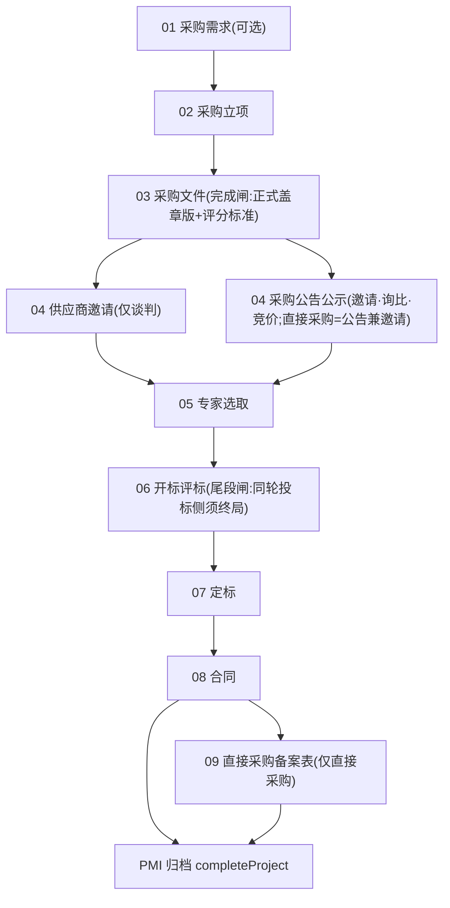
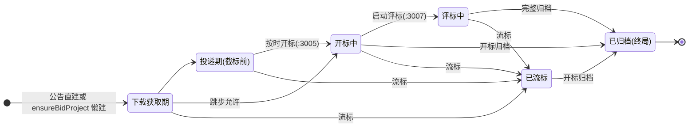
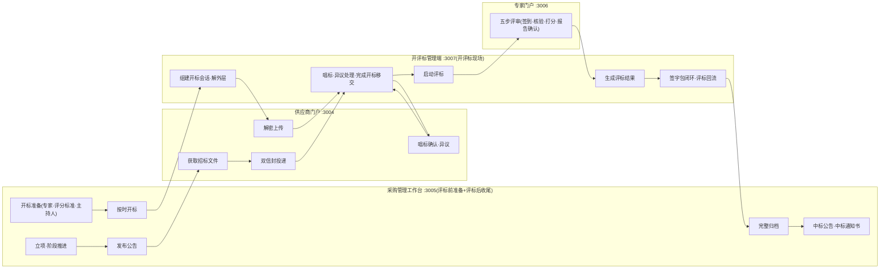
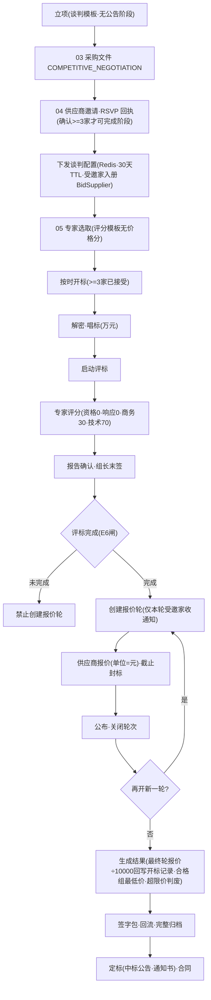
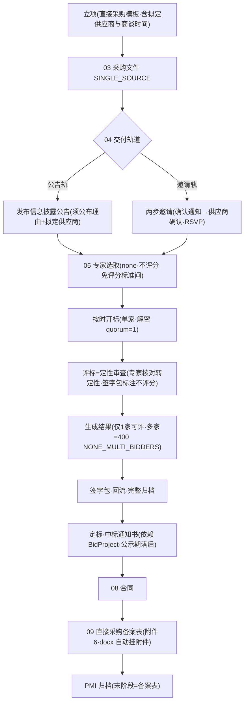
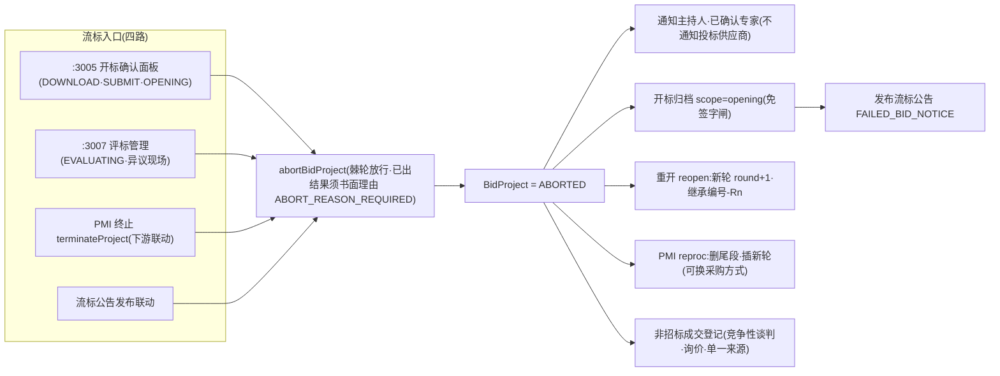
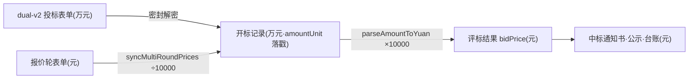

# 采购方式全流程梳理与逻辑问题报告

- **日期**: 2026-11-02
- **代码基线**: main @ `1488c123`（工作区干净）
- **审计范围**: `water-erp/` 全库（apps/api + 五门户 + packages/shared + packages/config）
- **方法**: 四路并行代码审计（方式目录 / 招标流程 / 非招标流程 / 闸门与遗留问题），关键断言由主会话逐条复核（立项五选项、流标转非招标词汇集、前端阶段模板、谈判配置存储与 TTL、评标办法映射、委员会组成规则）。所有结论均附 `文件:行` 证据（路径相对 `water-erp/`）。

---

## 1. 结论摘要

系统共有**六种采购方式**：公开招标、邀请招标、询比采购、竞价采购、谈判采购、直接采购（单一来源等为直接采购族别名）。全部方式跑在**同一套双状态机骨架**上——PMI 项目阶段机（10 个阶段、按方式套模板）+ BidProject 投标阶段机（DOWNLOAD→SUBMIT→OPENING→EVALUATING→ARCHIVED，+ABORTED 流标），差异通过「采购方式」字符串在约 40 处分支点实现（是否发公告、文件交付轨道、评标办法、报价轮、最少家数、档案豁免等）。

**主干逻辑成立**：两机联动（syncPmStage / 尾段闸 / 归档闸）已闭环，六模块 600+ 个唯一错误码构成完整闸门体系，四门户分工（:3005 准备+收尾 / :3007 现场执行 / :3006 专家评审 / :3004 供应商）与前后端口径总体一致。**无 P0/P1 级问题**。

剩余问题集中在（详见 §7）：**P2 结构性问题 7 项**——最需要关注的是谈判采购配置仅存 Redis 且 30 天 TTL 无持久化（本报告新核实）、PMI 回收站缺投标活动闸、流标不通知投标供应商、直接采购两条休眠断链；**P3 一致性/工程债 12 项**；**待裁定 4 项**；另有 6 项常见疑点已核实为「非问题」（防重复排查）。

---

## 2. 采购方式总目录

### 2.1 六种方式一览

| 方式 | 编号前缀 | 立项可选 | 发采购公告 | 采购文件交付 | 邀请/回执 | 评标办法(默认) | 报价轮 | 最少投递家数 | 评分模板 |
|---|---|---|---|---|---|---|---|---|---|
| 公开招标 | GK | **否**(仅公告直建) | 是(PUBLIC) | BidDocument | 无 | manual | 无 | 3 | 资格+响应+商务20+技术50+价格30 |
| 邀请招标 | YQ | 是 | 是(可 RESTRICTED 白名单) | BidDocument | selection 第三步 RSVP+白名单入册 | manual | 无 | 3(另:开放投递须≥3家已接受) | 同上 |
| 询比采购 | XB | 是 | 是 | BidDocument | 无 | manual | 无 | 3 | 同上 |
| 竞价采购 | JJ | 是 | 是(默认公开可切定向) | BidDocument | 无 | manual | sealed_auction 单轮(唱标价即终价) | 3 | 同上 |
| 谈判采购 | TP | 是 | **否(API 硬拒)** | **Redis negotiation-config**(BidDocument 恒空) | 邀请函 RSVP(确认≥3 家) | qualified_lowest_price | 有(negotiation 多轮,先评标后报价) | 3(须≥3家已接受) | 资格0+响应0+商务30+技术70，**无价格分** |
| 直接采购 | ZJ | 是 | 是(信息披露+须公布理由与拟定供应商) | BidDocument | 公告轨/两步邀请轨 | none(不评分) | 无 | **1** | 空 |

- 前缀映射：`apps/api/src/common/project-code.util.ts:16-28`（方式前两字拼音首字母）；编号格式 `<公司编码>-<前缀>-YYYYMMDD##`（如 `SWHI-TP-2026102003`），再采购继承宿主 PMI 编号加 `-R2` 后缀（:52-67）。
- 评标办法映射：`apps/api/src/bid/evaluation-method.config.ts:17-31`（2026-09-26 改定：竞争性方式默认 manual；谈判 qualified_lowest_price、直接采购族 none 为方式固有属性）。
- 最少家数：`apps/api/src/bid/decrypt-quorum.util.ts:5-8`（直接采购=1，其余=3；解密 quorum / 启动评标硬闸 / 详情下发三处消费）。

### 2.2 「采购方式」的多套口径并存（机器值=中文字符串，无英文枚举）

Prisma 各表 `procurementMethod String` 均为自由字符串（`apps/api/prisma/schema.prisma:402` BidProject、`:2703` ProjectManagementItem 等）。全库并存五套集合：

| 集合 | 位置 | 成员 | 用途 |
|---|---|---|---|
| 立项五选项(canonical) | `apps/web/src/lib/types/project-management.ts:1-7` | 谈判/竞价/直接/邀请/询比 | :3005 立项与重招唯一可选集（**不含公开招标**） |
| AI 识别集九方式 | `apps/api/src/project-management/project-management.service.ts:113-123` | 五方式+公开招标/单一来源采购/直接委托续约/框架协议/直接签订合同 | 国资委 PDF 提取识别 |
| 直接采购族 | `packages/shared/src/announcement-constants.ts:54-65` | 直接采购/单一来源/单一来源采购/直接委托续约/直接签订合同 | 公告理由要求、none 评标等族判定 |
| 流标转非招标三类 | `apps/api/src/bid/non-tender-deal.service.ts:5` | **竞争性谈判/询价/单一来源** | 流标后线下改用方式的成交登记（语义独立，非系统内流程） |
| 评标默认映射 | `apps/api/src/bid/evaluation-method.config.ts:17-31` | 五方式+legacy(公开招标/直接委托/续约) | 建项时落 evaluationMethod/roundMode |

口径分裂的影响见 §7（P3-5 词汇分裂、P3-6 公开招标无立项入口）。

### 2.3 公告类别可用性矩阵

`apps/web/src/lib/types/announcement.ts:32-38`：谈判采购**只能发流标/中标公告**（发采购公告被 API 拒：`announcement.service.ts:116-121` `NEGOTIATION_NO_PROCUREMENT_NOTICE`）；其余五方式有采购公告+流标+中标三类。

---

## 3. 双状态机与总体骨架

### 3.1 PMI 项目阶段机（project-management）

全集 10 个阶段（`apps/api/src/project-management/project-management.types.ts:1-13`），按方式套模板（`project-management.service.ts:147-200` METHOD_STAGE_TEMPLATES，前端镜像 `apps/web/src/lib/types/project-management.ts:26-79`）：

推进机制：

| 机制 | 路径 | 说明 |
|---|---|---|
| 手工推进 | `PATCH /project-management/:id/stages/:stageKey`（service:3556-3774） | 完成置下一阶段 IN_PROGRESS 并推 currentStage 指针；越过指针的完成=「补录」只改状态不推指针 |
| 自动推进 | `syncPmStage`（`bid/bid.service.ts:1965-2009`） | 仅两处调用：启动评标（06→IN_PROGRESS）；完整归档（06→COMPLETED，指针推到 07 定标并置 IN_PROGRESS——否则定标卡 NOT_STARTED 锁死通知书入口） |
| 回开 | `POST :id/stages/:stageKey/reopen`（service:3962-4048） | 仅 COMPLETED 可开；旧轮只读（PAST_ROUND_READONLY）；开标确认后前置阶段冻结（BID_OPENING_LOCKED）；重开重置同轮后续+后续轮 |
| 再采购 | `POST :id/reproc`（service:640-739） | 要求当前轮 BidProject 已流标；删尾段（定标/合同/备案表）插新轮；**可换采购方式** |
| 归档 | `POST :id/complete`（service:4050-4158） | 双闸：关联 BidProject 活动态 409 BID_IN_PROGRESS + 末阶段完成（直接采购=备案表、其余=合同）；生成台账 |

关键阶段完成闸（updateStage 内）：03 须正式盖章版指针（OFFICIAL_TENDER_REQUIRED :3845）+ 评分标准配置（SCORE_STANDARD_REQUIRED :3786，none 豁免）；谈判 04 须确认回执≥3 家（:3674-3706）；05 须本轮 BidExpert>0（:3707-3714，仅存在 BidProject 时）；06-09 尾段完成须同轮 BidProject 已终局（BID_IN_PROGRESS :3627-3645）——**「归档解锁定标」的正门 = 开标确认面板 archiveAll → syncPmStage**。

### 3.2 BidProject 投标阶段机（bid）

`apps/api/src/bid/bid-state.ts:26-40`——单向棘轮：只许前进、允许跳步、同阶段幂等；ARCHIVED 不可逆（唯一例外 ABORTED→ARCHIVED）：

注：流标后重开（reopen）**不是状态迁移**——新建 round+1 的 BidProject 行（编号继承宿主 PMI 加 `-Rn`）。实质准入闸门下沉到端点业务前置（阶段只是进度标记）：投递=OPENING 前+截标未到+公告已发布；解密=OPENING+解密窗口内；评分=EVALUATING+未确认锁定。

### 3.3 两机联动与设计权衡

- **双创建路径**：立项优先（PMI→懒建 BidProject `ensureBidProject` service:454-578，stage=DOWNLOAD、deadline=openTime−10 分钟）与公告优先（发布→`createFromAnnouncement` bid.service.ts:818-893 + 自动补建最小 PMI announcement.service.ts:1325-1345）并存；`syncBidProject`（announcement.service.ts:1204-1396）按「PMI 当前轮」命中决定建新还是更新。
- 这套「两机交错 + 三种建项入口」是历史 BID_IN_PROGRESS 系列问题的主要根源，现已用闸门矩阵（§6）收口：公告删除、PMI 归档、PMI 尾段完成、PMI 终止四处同源闸。
- 遗留一个缺口：PMI **回收站**无此闸（§7 P2-2）。

### 3.4 四门户协作总览（公告型方式主干）

---

## 4. 各采购方式流程详解

### 4.1 公告型四方式（公开招标 / 邀请招标 / 询比 / 竞价）

四者共用上节主干，逐步如下：

| 段 | 步骤 | 操作方(门户) | 端点/位置 | 关键闸门 |
|---|---|---|---|---|
| 1 立项 | PMI 创建+阶段推进 | :3005 | `POST /project-management/extract-initiation`(AI 解析立项 PDF)或 `POST /project-management`；`PATCH /:id/stages/:stageKey` | 公司归属写时快照 |
| 2 采购文件 | 03 阶段附件+正式盖章版指针+评分标准配置 | :3005 | `POST /:id/stages/:stageKey/official-tender`（service:159）；tender-write/tender-review 为独立编制与 AI 审查工具，**非必经** | OFFICIAL_TENDER_REQUIRED / SCORE_STANDARD_REQUIRED |
| 3 建项 | BidProject 懒建 | — | `GET /project-management/:id/bid-project`（ensureBidProject service:454-578） | stage=DOWNLOAD、deadline=openTime−10min |
| 4 公告 | 三步向导(信息/发布配置/预览发布) | :3005 | `POST /api/announcements`（announcement.service.ts:81-235） | 依法必招时间预检(售标→开标≥20日/发售≥5日，非必招偏离留痕放行 :1127-1156)；GB 赋码 :100；正式文件引用一致 :1166 |
| 4b 发布副作用 | attachFromObject 建 BidDocument → syncBidProject 或直建+补建 PMI → AI 分析入队 → 按可见范围通知 | API | service:174-191, 1204-1396, 1055-1122 | 定时发布走 update 同闸（Scheduler 每分钟） |
| 5 邀请(仅邀请招标) | selection 第三步：模板通知+RSVP 回执+白名单入册 | :3005/供应商 | `POST /api/ai/generate-notification`(contentMode=template) 建 InvitationRsvp+短 token 链接；游客回执 `POST /api/supplier/rsvp/respond`；`POST /bid/projects/:id/suppliers`（bid.service.ts:6344-6423） | 跨公司邀请 CROSS_COMPANY_INVITE :6379；开放投递另须≥3家已接受 assertMinAcceptedInvitees :1441 |
| 6 供应商参与 | 可见性→文件获取→投递→撤回/重投 | :3004 | 列表 `GET /supplier-portal/bid-projects`(读闸 COMPANY_SCOPE_FORBIDDEN :1912)；文件三端点(checkEligibility OPEN=本公司库 :326-355)；投递 `POST /bid-submissions/:projectId/submit`（service:2200-2385，SCCA dual-v3 双层加密+P7 签名） | ALREADY_SUBMITTED/黑名单/未审批/PROJECT_NOT_SUBMITTING/DEADLINE_PASSED/SM2_SIGNATURE_INVALID 等；报价只存 sealedFields(万元)服务端不可读 |
| 7 开标准备 | 投标状态+催促、专家抽取+RSVP(15min 超时自动弃权递补)+正选候补替换、唱标字段配置、主持人指派、开标决策 | :3005 | bid-confirm-panel.tsx；`POST /bid/projects/:id/open`(按时开标 bid.service.ts:1729-1956) | HOST_NOT_ASSIGNED/DEADLINE_NOT_PASSED/OPENING_CHECKLIST_FAILED——**硬闸=提交家数≥法定不可 force**，软闸=专家未分配可 force；成功→OPENING+syncPmStage |
| 8 开标 | 会话组建→主持端解外层→供应商解密上传→异常归因→唱标录入→确认/异议/裁决→完成开标移交(文件包+WS 回传 :3005) | :3007/:3004 | `POST /:id/opening/decrypt-outer`、`POST .../decrypt-upload`、`POST .../opening-records`、`POST .../complete-opening`（bid.service.ts:1116-1239） | 解密窗口五闸 :1814-1881；RECORD_ALREADY_CONFIRMED(H11)；PRICE_UNIT_SUSPECT(万元/元) |
| 9 评标 | 启动评标→专家五步(签到/回避/评标室口令/标书解密/AI 辅助/打分/报告确认/组长末签/esign)→澄清应邀→(谈判:报价轮)→结果生成 | :3007/:3006 | `POST /:id/start-evaluation`（bid.service.ts:2199-2407）；`POST /:id/evaluation-results/generate`（bid-evaluation-results.service.ts:124+） | 启动链：EXPERT_WINDOW_CONFLICT/NO_EXPERTS_ASSIGNED/委员会组成(默认≥5人单数、水利≥7人、小项目底线3人、技术经济专家≥2/3，committee-composition.util.ts)/NO_EVALUABLE_SUPPLIERS/OPENING_NOT_DONE/评分标准完整/CEILING_PRICE_REQUIRED；生成链：EXPERT_REPORTS_NOT_CONFIRMED/LEADER_NOT_COSIGNED/OPEN_DISPUTES/SIGN_PACKET_CLOSED/ROUNDS_NOT_CLOSED(谈判)；EVALUATION_OVERDUE 只拦结果链(法定) |
| 10 收尾 | 签字包(生成 PDF→打印→逐专家登记三态→闭环)→回流包→完整归档 | :3007/:3005 | sign-packet 端点族；`POST /:id/archive-all {scope:full}`（bid.service.ts:4100-4326） | 签字三闸 assertSignGateClosed；逐项 SHA-256 哈希链+15 年保存期；成功→ARCHIVED+syncPmStage+预成交公示草稿 |
| 11 定标文书 | 中标公告(公示期 3 日推导)→公示期满→中标通知书送达签收→未中标站内信→保证金退还提醒 | :3005/:3004 | `POST /:id/award-letter/deliver`（bid.service.ts:4622-4700） | PUBLICITY_NOT_ENDED(实施条例54条)/WINNER_MISMATCH/AWARD_LETTER_ALREADY_SIGNED |
| 12 合同与归档 | PMI 07 定标/08 合同阶段推进+附件→PMI 归档出台账 | :3005/:3004 | 供应商合同状态机 approved_for_signing→signed→performing→accepted | completeProject 双闸 |

**四方式差异表**：

| 维度 | 公开招标 | 邀请招标 | 询比 | 竞价 |
|---|---|---|---|---|
| 立项入口 | **无**(仅公告直建缺省 announcement.service.ts:1331) | 有 | 有 | 有 |
| 公告可见性 | PUBLIC(公司归属内全员) | 可 RESTRICTED+白名单(通知仅白名单) | PUBLIC | PUBLIC 预载白名单可切 RESTRICTED |
| 文件模板 | legacy | INVITED_BIDDING | INQUIRY_PURCHASE(v2 固定综合评分法+空表拒导出 tender-write.service.ts:169-189) | INTERNAL_BIDDING |
| roundMode | null | null | null | **sealed_auction**(单轮密封+唱标即终价；结果生成豁免轮次闸 bid-evaluation-results.service.ts:166-169；报价轮 tab 不渲染) |
| 公告截止默认 | 5天/投标10天 | 5天/10天 | **3天/5天** | **3天/5天** |
| 投递资格 | 公告型全体 | 公告型(定向靠名单；INVITATION_SCOPED_METHODS 仅直接/谈判 supplier-portal.service.ts:170) | 同公开 | 同公开 |

### 4.2 谈判采购

要点（证据）：

- **不发采购公告**：API 硬拒（NEGOTIATION_NO_PROCUREMENT_NOTICE）；供应商端详情页以「采购邀请书」DOCX 预览替代公告位（supplier bids/[id]/page.tsx:612-648）。
- **邀请链**：:3005 `/supplier/selection` 五步（AI 推荐→候选→模板通知+RSVP→附件选择→供应商确认）；回执确认即回填 BidSupplier 并懒建 BidProject（rsvp.service.ts:189-226）；婉拒移出候选。
- **文件交付**：`POST /api/supplier/negotiation-config`（supplier.service.ts:4295-4379）写 Redis `negotiation-config:{projectId}`（**EX 30 天，无落库表**——见 P2-1）；字段=supplierIds/获取窗口/开标时间/refFileKeys(PMI 附件主轨)/attachFileIds(FileAsset 兜底)/downloadMode；截标过后重发 409 DEADLINE_FROZEN。供应商端专用下载 `GET /supplier-portal/bid-projects/:id/negotiation-files(+/:fileId/download)`，闸=受邀+窗口+FILE_NOT_IN_CONFIG（supplier-portal.service.ts:1796-1887）。专家端 `resolveTenderDocumentMeta` 公告轨 miss 回退谈判轨（expert.service.ts:945-1106）；AI worker 同口径（plaintext-fetcher.service.ts:201-209）。
- **先评标→再报价**：E6 闸——评标未完成禁止创建报价轮（bid.service.ts:5213-5217）；报价轮生命周期 开轮→报价(元)→封标→公布→关闭（:5209-5350）；结果生成须 ≥1 轮且全部 closed（bid-evaluation-results.service.ts:169-182），最终轮报价 **元÷10000 回写开标记录(万元)**（syncMultiRoundPrices bid.service.ts:5367），合格组按最终报价升序第 1 名推荐。
- 中标/流标公告照常；档案豁免预成交公示。

### 4.3 直接采购

要点（证据）：

- 公告轨走向导 SINGLE_SOURCE 特化（自动读拟定供应商+AI 生成论证意见，wizard:841-862）；GB/T 43711 7.2.2.3 要求公布直接采购理由及拟邀请供应商（announcement-constants.ts:51-60）。
- none 轨：评分模板空、免评分标准配置闸（service:3793）、专家核对转定性审查（expert.service.ts:2119）、签字包「直接采购·不评分」页（bid-sign-packet-docx.service.ts:184）。
- **单一成交对象口径**：可评供应商>1 家时结果生成 400 NONE_MULTI_BIDDERS（bid-evaluation-results.service.ts:188-196，2026-10-19 裁定）。
- **09 备案表是归档闸认定的末阶段**（completeProject service:4102-4110）；档案仅 8 类（无公告/响应/开标记录/评审报告/预公示，procurement-archive.ts:36,48-50）。

### 4.4 流标与再采购

- abort 端点 `POST /bid/projects/:id/abort`（bid.controller.ts:504）后端不限时间窗（窗口口径纯前端：DOWNLOAD/SUBMIT=开标前 24h 起、OPENING 恒可点，BID_ABORT_WINDOW_BEFORE_OPENING_MS packages/shared/src/constants.ts:183）。
- PMI 终止事务内联动：非终态 BidProject 全置 ABORTED+监督日志→已发布公告下架→未完成工作安排取消（service:4228-4420）。
- 流标后三条续路：①reopen（bid.service.ts:1578-1693，投标侧新轮）②reproc（PMI 侧新轮，可换方式）③非招标成交登记（non-tender-deal.service.ts，线下改用方式的结构化入档+成交文件挂 PMI 定标附件）。

---

## 5. 共性机制

### 5.1 双信封与 CA

投标前端已迁 SCCA dual-v3 轨（loginScca→encryptAndUploadV3 双层加密+信封 revision CAS→signSccaP7）；dual 轨报价只存 sealedFields（万元）服务端不可读（supplier-portal.service.ts:2338）；管理方外层私钥 kadmin 解 C_inner；旧轨（clientDeks）API 仍放行但门户表单已下线（LEGACY_TRACK_CLOSED 拒 dual-v2 之外的旧形态投递口径见 CLAUDE.md 2026-09-29 修正）。

### 5.2 金额单位链（2026-09-14 铁律）

分界：开标记录侧=万元；BidQuote/评标结果/通知书侧=元；跨侧桥接仅 syncMultiRoundPrices 与 generateEvaluationResults 两处；录入闸 PRICE_UNIT_SUSPECT 只拦万元→元方向（opening-amount-unit.util.ts:79-100）。**新读端禁止裸读裸算 amount/decryptedPrice。**

### 5.3 结果文书与通知（六方式共用一套，无方式分支）

- 成交供应商：定标上传通知书文件→`POST /:id/award-letter/deliver`（公示期满硬闸）→站内信 AWARD_LETTER（仅 in_app，无短信——P3-7）→台账 awardedSupplier 回写→供应商 /award-letters 查看·签收·回执。
- 未成交供应商：同点定向站内信 BID_AWARD_RESULT（口径=已投递家排除中标人，幂等 marker；直接采购单家无落标者）。
- 公开面：完整归档自动生成预成交公示草稿；实际主载体=发布向导「中标公告 WIN_BID_NOTICE」（发布即确认 rank1；公示期=publishDate+3 日读时推导）。
- 过程通知：BID_ROUND_OPEN（仅本轮受邀家）、BID_ABORTED（主持+专家，**不含投标供应商**——P2-3）、BID_INVITED、BOND_REFUND_DUE。

### 5.4 档案豁免矩阵（GB/T 43711 + DA/T 103）

`packages/shared/src/procurement-archive.ts:38-57`（基线 13 类）：

| 方式 | 豁免 | 归档类别数 |
|---|---|---|
| 公开/邀请招标 | 无 | 13 |
| 询比 | 免预成交公示 | 12 |
| 竞价 | 免预成交公示+评审报告 | 11 |
| 谈判 | 免预成交公示 | 12 |
| 直接采购族 | 仅 8 类(plan/prequal/document/win/award_letter/contract/acceptance/dispute) | 8 |

---

## 6. 闸门矩阵（按环节分组，均已代码核实）

### 公告与立项

| 闸门 | 触发条件 | 位置 |
|---|---|---|
| NEGOTIATION_NO_PROCUREMENT_NOTICE | 谈判采购发 BID_NOTICE | announcement.service.ts:116 |
| 依法必招时间预检(B-004/B-009) | 售标→开标<20 日/发售期<5 日（非必招偏离留痕放行） | announcement.service.ts:1127-1156 |
| 正式文件引用一致 / GB 赋码 | 公告引用与盖章版不一致 / 未赋码 | announcement.service.ts:100,1166 |
| BID_IN_PROGRESS(公告删除) | PUBLISHED 且 type=BID_NOTICE 且项目 SUBMIT/OPENING/EVALUATING；其余态仅解关联 | announcement.service.ts:1396-1440 |

### PMI 阶段

| 闸门 | 触发条件 | 位置 |
|---|---|---|
| OFFICIAL_TENDER_REQUIRED / SCORE_STANDARD_REQUIRED | 03 完成无盖章版指针 / 无评分标准(none 豁免) | project-management.service.ts:3786,3845 |
| 谈判 04 回执≥3 | 确认回执(按供应商去重)不足 | service:3674-3706 |
| 05 专家>0 | 有 BidProject 而本轮无 BidExpert | service:3707-3714 |
| BID_IN_PROGRESS(尾段闸) | 06-09 尾段标 COMPLETED 前同轮 BidProject 未终局(补录同受闸) | service:3627-3645 |
| PMI_NOT_ACTIVE | 8 个写端点在 status≠ACTIVE | service:3508(assertPmiMutable) |
| PAST_ROUND_READONLY / BID_OPENING_LOCKED | 历史轮写 / 开标确认后重开前置阶段 | service:3592,3990 |
| reproc 链 | REPROC_ALREADY_PENDING/BID_NOT_ABORTED/TAIL_HAS_ATTACHMENTS | service:668-745 |
| BID_IN_PROGRESS(PMI 归档) | completeProject 时关联 BidProject 活动态(不分轮次查全表)+末阶段完成闸 | service:4065-4110 |
| **(缺)回收站闸** | moveToRecycleBin 无 BID_IN_PROGRESS 检查 | service:6047-6067（→P2-2） |

### 投递与文件

| 闸门 | 触发条件 | 位置 |
|---|---|---|
| checkEligibility | OPEN=本公司库(平台级 null 全员)；INVITED=白名单∪BidSupplier | bid-document.service.ts:326-355 |
| assertCanSubmitBid 系列 | 已投递/黑名单/未审批/阶段(仅 DOWNLOAD·SUBMIT)/截标/邀请域 INVITATION_REQUIRED/密文与 PDF 校验/SM2 验签 | supplier-portal.service.ts:2117-2385 |
| assertMinAcceptedInvitees | 邀请域开放投递须≥3 家 ACCEPTED | bid.service.ts:1441 |
| DEADLINE_FROZEN / CROSS_COMPANY_INVITE | 谈判配置截标后重发 / 跨公司邀请 | supplier.service.ts:4320,4346 |
| negotiation-files 下载闸 | NOT_INVITED/NO_CONFIG/ACQUIRE_NOT_STARTED·ENDED/FILE_NOT_IN_CONFIG | supplier-portal.service.ts:1796-1887 |

### 开标

| 闸门 | 触发条件 | 位置 |
|---|---|---|
| HOST_NOT_ASSIGNED / DEADLINE_NOT_PASSED / OPENING_CHECKLIST_FAILED | 按时开标链(硬=家数≥法定不可 force；软=专家可 force) | bid.service.ts:1729-1956 |
| 会话闸五码 | 会话字段不全/窗口非法/早于开标/已过期/缩短窗口/OPENING_SESSION_LOCKED | bid.service.ts:1814-1881 |
| 解密包闸 | 窗口未开·已闭/签到 quorum/OUTER_NOT_DECRYPTED/NO_SUBMISSION | supplier-portal.service.ts:3341+ |
| RECORD_ALREADY_CONFIRMED(H11) / RECORD_LOCKED / PRICE_UNIT_SUSPECT | 唱标已确认禁覆盖 / 四态锁定 / 万元↔元方向嫌疑 | bid-opening-record.service.ts:150-222; opening-amount-unit.util.ts:79-100 |
| OPENING_NOT_DONE | 完成开标须全员终局态(幂等·不改阶段) | bid.service.ts:1116-1239 |

### 评标与结果

| 闸门 | 触发条件 | 位置 |
|---|---|---|
| startEvaluation 链 | EXPERT_WINDOW_CONFLICT/NO_EXPERTS_ASSIGNED/委员会组成(≥5 或水利≥7 人单数·技术经济≥2/3)/NO_EVALUABLE_SUPPLIERS/INSUFFICIENT_BIDDERS/OPENING_NOT_DONE/评分标准完整/CEILING_PRICE_REQUIRED | bid.service.ts:2199-2407; committee-composition.util.ts |
| 专家侧 | EVALUATION_NOT_STARTED/IDENTITY_NOT_VERIFIED/ROOM_CODE_REQUIRED/SCORE_LOCKED/REPORT_ALREADY_CONFIRMED/SCORING_INCOMPLETE | expert.service.ts:543-2585 |
| EVALUATION_OVERDUE | 仅拦 submitScores/confirmReport/结果生成；澄清·回避·异议·动议法定放行 | expert.service.ts:1542; bid-evaluation-results.service.ts:129 |
| 结果生成链 | PROJECT_NOT_EVALUATING/EXPERT_REPORTS_NOT_CONFIRMED/LEADER_NOT_COSIGNED/OPEN_DISPUTES/SIGN_PACKET_CLOSED/ROUNDS_NOT_CLOSED(谈判·竞价豁免)/NONE_MULTI_BIDDERS(直接) | bid-evaluation-results.service.ts:126-196 |
| 报价轮 | createRound:阶段闸+RESULTS_FROZEN+谈判 E6+单 open 轮；submitQuote:ROUND_NOT_OPEN/DEADLINE_PASSED/ALREADY_QUOTED/RESULTS_FROZEN | bid.service.ts:5209-5304; supplier-portal.controller.ts:848-905 |
| 异议裁决 | 仅 EVALUATING；采纳联动废标+清结果+失效签字包 | bid.service.ts:4956-5070 |

### 收尾与结果发布

| 闸门 | 触发条件 | 位置 |
|---|---|---|
| 签字包 | SIGN_PACKET_NOT_GENERATED/SIGN_PACKET_CLOSED/SIGN_ALREADY_REGISTERED/三态登记(拒绝须书面不同意见) | bid-sign-packet.service.ts:144-201 |
| SIGN_HANDOVER_NOT_CLOSED | 回流须全员闭环 | bid-sign-packet.service.ts:340 |
| archiveAll(full) | EVALUATION_RESULTS_REQUIRED/OPENING_RECORDS_MISSING/签字三闸；opening 范围要求移交包已生成 | bid.service.ts:4100-4326 |
| PUBLICITY_NOT_ENDED / WINNER_MISMATCH / AWARD_LETTER_ALREADY_SIGNED | 通知书链(实施条例 54 条) | bid.service.ts:4622-4700 |
| PUBLICITY_ENDED / OFFLINED | 公告期满回 200 标题壳(剥附件·不计浏览) | announcement.service.ts:424-541 |

### 数据隔离与权限

| 闸门 | 触发条件 | 位置 |
|---|---|---|
| COMPANY_SCOPE_FORBIDDEN | 供应商读=归属∪受邀∪本人投递 | supplier-portal.service.ts:1913-1930 |
| PMI_READ_ONLY / NOT_ASSIGNED_HOST | 非创建人写 PMI / :3007 现场权跟随指派 | pmi-ownership.guard.ts:68; assigned-host.guard.ts:35 |

---

## 7. 逻辑问题清单

分级标准：P0=资金/法律即刻风险；P1=主流程死锁；P2=特定路径断链或数据丢失风险；P3=一致性/体验/工程债。

### 7.1 P2（建议排期修复，共 7 项）

| # | 问题 | 现象与证据 | 影响 |
|---|---|---|---|
| P2-1 | **谈判配置仅存 Redis、30 天 TTL、无落库**（本报告新核实） | 写入 `EX 86400*30`（supplier.service.ts:4295-4379），全库无持久化表、无重建源；读取五处：供应商端 :1809/:1895、专家端 expert.service.ts:956/:1049、AI worker plaintext-fetcher.service.ts:209 | 30 天后或 Redis 重启后，谈判项目供应商文件获取/专家文件核对/AI 取文三轨全断；采购文件交付属法定过程数据，窗口时点虽回写 BidProject 但文件指针集(refFileKeys/attachFileIds)丢失 |
| P2-2 | **PMI 回收站缺 BID_IN_PROGRESS 闸 + syncPmStage 穿透冻结** | moveToRecycleBin 无闸（service:6047-6067；对照 completeProject:4080/terminate:4293 均有）；投标侧 syncPmStage 写 PMI 阶段/指针不查 PMI 状态（bid.service.ts:1965-2010） | 创建人可在 BidProject 活动态时回收 PMI；回收期间 PMI_NOT_ACTIVE 冻结被穿透、阶段照常推进；可 restore 故非死锁，但台账/阶段口径错乱 |
| P2-3 | **流标不通知已投递供应商** | abortBidProject 仅通知指派主持人+已确认正选专家（bid.service.ts:1524-1547） | 已投递供应商只能靠人工发流标公告或 PMI 终止 notify 获知；合规(办法 42 条通知义务)与体验风险 |
| P2-4 | **直接采购 0 公告断链（休眠中）** | 供应商端 getBidProjectDocument 仅公告轨无直接采购回退（supplier-portal.service.ts:2100-2113）；专家端 resolveTenderDocumentMeta 仅回退谈判轨（expert.service.ts:999-1000）；直接采购未发公告且配专家时两端 NOT_FOUND | 当前被 NO_EXPERTS_ASSIGNED（bid.service.ts:2252）挡在启动评标前未爆发；一旦直接采购项目配了专家即触发 |
| P2-5 | **直接采购邀请轨未确认 RSVP 时定标链不可走** | 通知书 deliverAwardLetter 与 my-outcome 均以 BidProject 为宿主；无公告且供应商未确认回执→BP 未懒建（唯一懒建点 rsvp.service.ts:219-226），无兜底端点 | 只能改发中标公告或线下发通知书 |
| P2-6 | ROLE_PORTAL 无 leader/staff | packages/config/src/urls.ts:45-50 | 两角色登录跳转兜底缺口 |
| P2-7 | 在册合规缺口群（非新发现，存档） | docs/在线招投标系统功能差距分析-2026-09-16.md §一/§二：在线支付、真 CA 厂商对接、PDF 可视电子印章、远程异地评标音视频、未中标原因反馈(A-173)、处罚登记管理端、投标 IP/设备指纹 | 认证合规差距，按规划补齐 |

### 7.2 P3（一致性/体验/工程债，共 12 项）

| # | 问题 | 证据 |
|---|---|---|
| P3-1 | 竞价报价轮死代码+误用风险：createRound 只查 roundMode 非空，sealed_auction 可经 API 开轮；结果生成对 sealed_auction 豁免轮次闸与报价同步，轮内报价不会回写唱标价(syncMultiRoundPrices 仅谈判路径)；UI 无入口但组件保留竞价分支 | bid.service.ts:5211-5212; bid-evaluation-results.service.ts:166-183; project-tabs.tsx:11 vs round-block.tsx:44-48。建议 createRound 显式拒 sealed_auction 或删分支 |
| P3-2 | 询比评分法两层口径差：文书 v2 固定综合评分法+空表拒导出 vs 系统默认 manual 逐项目可调，无对齐校验(评分标准配置闸 Σ=100 是事实交汇点) | tender-write.service.ts:169-189 vs evaluation-method.config.ts:26 |
| P3-3 | extend-evaluation 未联动「通知所有投标人延长投标有效期」(评标委暂行规定 40 条/30 号令 29 条，CLAUDE.md 在册 Backlog) | — |
| P3-4 | 归档证据链谈判项目 BidDocument 标题恒空(附件主轨仍经 PMI Attachment 收纳，仅标题缺) | archive-template.ts:49 |
| P3-5 | 方式词汇分裂：流标转非招标用[竞争性谈判/询价/单一来源]，主目录用[谈判采购/询比采购/直接采购]——语义独立(线下成交登记)但同名概念异名，统计/报表口径易混 | non-tender-deal.service.ts:5 |
| P3-6 | 公开招标无 :3005 立项入口(五选项不含)，实际来源=公告直建缺省+legacy 识别；路径不对称，驾驶舱按方式统计口径受入口影响 | project-management.ts:1-7; announcement.service.ts:1331 |
| P3-7 | 中标通知书仅站内信无短信(邀请函有短信)；未见刻意为之的裁定记录 | bid.service.ts:4807-4825 |
| P3-8 | 招标文件下载全量内存解密(大文件内存峰值，TODO 流式) | bid-document.service.ts:395-399 |
| P3-9 | 旧轨 SM2 客户端签名恒空跳过(旧轨表单已下线，影响面收敛中) | supplier-portal.service.ts:2261-2266 |
| P3-10 | 数据/展示债：同名公告 YQ-2026091004×2 不可清；大屏 :3010 静态写死 | apps/bigscreen/src/app/page.html |
| P3-11 | createFromInitiation 陈旧注释(称直接采购模板无采购文件步骤，与现行模板矛盾) | project-management.service.ts:1204-1206 |
| P3-12 | 面板几乎不特判错误码(全库仅 evaluation-view 一处)，闸门以原始 400/409 文案透出——体验粗糙非不一致 | — |

### 7.3 待裁定（4 项）

1. 监督者独立角色在 2026-10-15 AssignedHostGuard 体系后的残留程度（未逐一重验）。
2. AssignedHostGuard 17+6 端点覆盖面是否仍与主持端点集对齐（未复核）。
3. 谈判配置 30 天 TTL 是否覆盖「评标+多轮报价+归档」最长周期→是否落库（对应 P2-1）。
4. 询比评标办法以文书层（固定综合评分法）还是系统层（manual 可调）为准（对应 P3-2）。

### 7.4 已核实为「非问题」（防重复排查）

1. PMI 已 ARCHIVED 而 BidProject 活动态——completeProject+尾段闸双闸封死。
2. BidProject 已 ARCHIVED 而 PMI 尾段未完成——正常中间态（归档→syncPmStage 自动推进定标）。
3. 评标超时后澄清/回避/异议/动议仍可写——法定设计（澄清限范围不限时刻），EVALUATION_OVERDUE 只拦结果链。
4. 多轮报价与开标记录同步无半写风险——校验前置+事务+幂等 upsert。
5. 竞价豁免「结果前轮次全关」闸——设计（单轮密封+唱标即终价）。
6. 竞价无专属倒计时/排名模块——复用开标大厅与评标矩阵通用件，够用。

---

## 附录 A：证据来源与核实方式

| 板块 | 调研路径 | 主会话复核项 |
|---|---|---|
| 方式目录/分支点 | 全库枚举 procurementMethod 分支（API+web+supplier 门户） | 立项五选项原文；NON_TENDER_METHODS 语境；前端阶段模板全文 |
| 公开/邀请招标流程 | announcement/supplier-portal/bid/expert/project-management 五模块 + 三门户页面 | — |
| 非招标四方式流程 | project-management 阶段机 + tender-write + selection 向导 + 供应商端面 | evaluation-method.config.ts 全文 |
| 闸门与遗留问题 | 六模块错误码枚举 + docs Backlog + 状态机死角推演 | 委员会组成规则全文(committee-composition.util.ts) |
| 谈判配置存储 | 全库 grep `negotiation-config` | 写入处 TTL(EX 30 天)与读取五处 |
