# 采购方式流程图册

- 日期 2026-11-02 · 依据当日主分支代码梳理
- 阅读说明：全部图为**横向紧凑布局**；双线框节点代表**子过程**，本册后有专图展开；各图只标关键闸门，完整闸门矩阵与问题清单见同目录《采购方式全流程梳理与逻辑问题报告》。

---

## 一、两台状态机（全方式共用骨架）

### 图 1 · 投标项目阶段机（单向棘轮：只前进、可跳步、已归档不可逆）

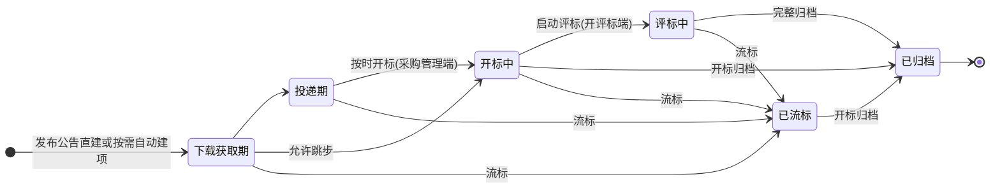

注：流标后「重开」不是状态迁移——新建轮次加一的新项目行，编号追加轮次后缀。

### 图 2 · 项目管理阶段机（十个阶段按方式套模板，阶段指针单向推进）

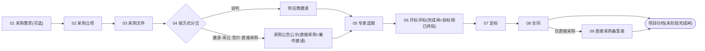

---

## 二、四个公共子过程

### 图 3 · 采购文件编制（项目管理 03 阶段，权威源=阶段附件）

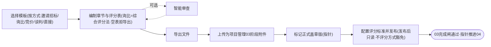

### 图 4 · 供应商邀请（邀请招标第三步 / 谈判五步 / 直接采购两轨）

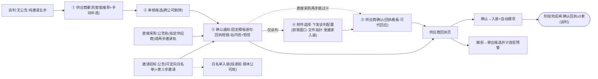

### 图 5 · 公告编写发布（信息发布中心三步向导）

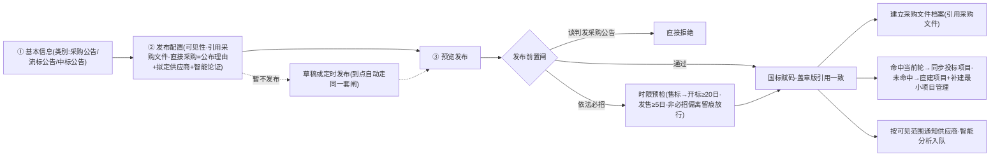

### 图 6 · 专家抽取（六步向导 → 开标面板替换 → 启动评标校验）

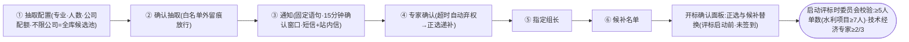

---

## 三、开评标公共主干（六方式共用）

### 图 7 · 投递与开标（供应商门户投递 → 采购管理端准备 → 开评标端现场）

### 图 8 · 评标与收尾（开评标端 / 专家端 / 采购管理端 → 结果与文书）

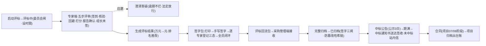

---

## 四、各采购方式总流程（双线框=引用上文子图）

### 图 9 · 公告型四方式（公开招标 / 邀请招标 / 询比 / 竞价）

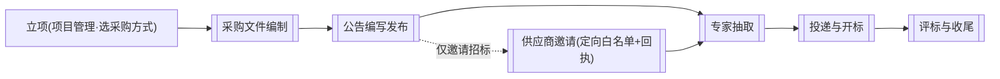

差异一句话：公开招标不经立项向导、由发布公告直接建项；邀请招标=定向白名单+邀请步、投递前须不少于 3 家已接受邀请；询比=截止 3 天/5 天快节奏；竞价=单轮密封、唱标价即终价（豁免报价轮闸）。

### 图 10 · 谈判采购（无公告：邀请书替代；先评标→再多轮报价→最低价定标）

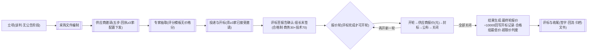

### 图 11 · 直接采购（单一成交对象·不评分·多备案表尾段）

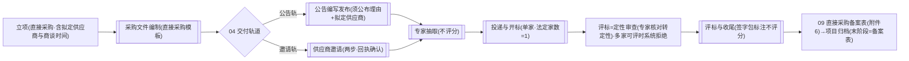

### 图 12 · 流标与再采购（四入口 → 已流标 → 三条续路）

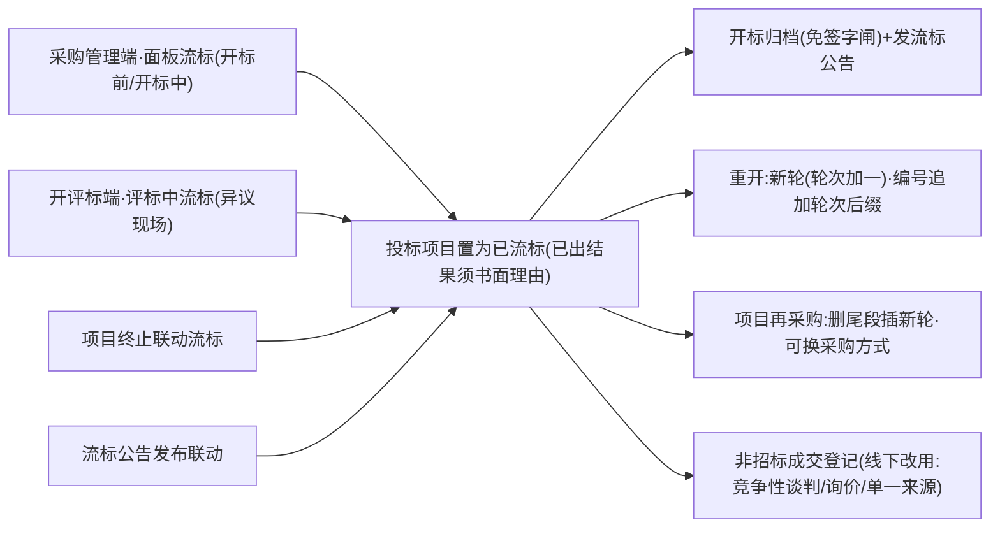

### 图 13 · 金额单位链（万元/元分界铁律）

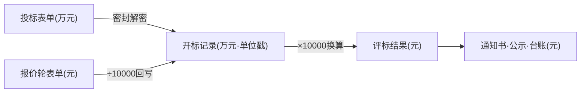
